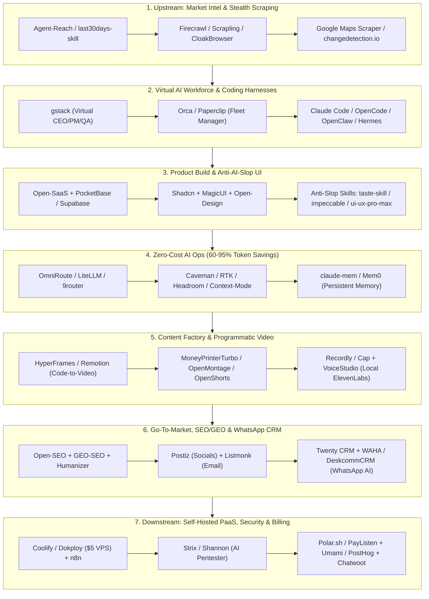

<div align="center">

# 🚀 Awesome One-Person Company (Hulu–Hilir)

**The Living, End-to-End Open-Source & Agentic AI Stack for Solopreneurs, Indie Hackers, and One-Person Companies.**

[-104_Verified-10b981?style=for-the-badge)](https://github.com/ridloabelian/awesome-one-person-company)
[](./data/verified_status.json)
[](./SKILL.md)
[](./LICENSE)

**[🌐 English](./README.md) | [🇮🇩 Bahasa Indonesia](./README.id.md) | [🪦 Stale Graveyard](./GRAVEYARD.md) | [🤖 Agent Skill (`SKILL.md`)](./SKILL.md) | [🐳 $5/mo VPS Stack](./stacks/lean-solopreneur-vps/)**

</div>

---

## ⚡ Why This Repository Exists

Most `awesome-indie` or `solopreneur` lists on GitHub suffer from three fatal flaws:
1. **Full of Abandonware:** Half the repositories haven't seen a commit since 2024.
2. **SaaS Subscription Traps:** They recommend $29–$199/mo SaaS tools that bleed solo founders dry before reaching Product-Market Fit.
3. **Missing the 2026 Agentic Stack:** They ignore **AI Agent Harnesses**, **Token Cost-Cutters (60–95% savings)**, **Anti-AI-Slop Design Skills**, and **Programmatic Video Engines**.

> [!IMPORTANT]
> **Strict 30-Day Maintenance Guarantee:** Every repository listed below is automatically audited via GitHub GraphQL API. Only repositories with active code pushes in the last **30 days** (since `2026-10-01`) survive on the main list. Stale projects are automatically moved to [GRAVEYARD.md](./GRAVEYARD.md).

---

## 🗺️ End-to-End One-Person Company Architecture (Hulu → Hilir)



---

## 📑 Table of Contents

- [1. Upstream: Market Intelligence, Trend Discovery & Stealth Scraping](#1-upstream-market-intelligence-trend-discovery-stealth-scraping) (13 active repos)
- [2. The 1-Person AI Workforce: Autonomous Agents, Harnesses & Virtual Teams](#2-the-1-person-ai-workforce-autonomous-agents-harnesses-virtual-teams) (15 active repos)
- [3. Product Development: SaaS Boilerplates, Anti-AI-Slop UI & Backend-in-a-Box](#3-product-development-saas-boilerplates-anti-ai-slop-ui-backend-in-a-box) (16 active repos)
- [4. Zero-Cost AI Ops: Token Compressors, Free AI Gateways & Agent Memory](#4-zero-cost-ai-ops-token-compressors-free-ai-gateways-agent-memory) (10 active repos)
- [5. Content Factory, Programmatic Video & Creative Suite (Organic Distribution)](#5-content-factory-programmatic-video-creative-suite-organic-distribution) (13 active repos)
- [6. Go-To-Market: SEO/GEO, Paid Ads, Social Scheduling & WhatsApp CRM](#6-go-to-market-seogeo-paid-ads-social-scheduling-whatsapp-crm) (15 active repos)
- [7. Downstream & Back-Office: Self-Hosted PaaS, Automation, Pentesting, Billing & Analytics](#7-downstream-back-office-self-hosted-paas-automation-pentesting-billing-analytics) (22 active repos)
- [💡 The Ultimate $5/mo Lean VPS Stack](#-the-ultimate-5mo-lean-vps-stack)
- [🤖 Use as an AI Agent Skill](#-use-as-an-ai-agent-skill)
- [🪦 Eliminated Stale Repositories (>30 Days Inactive)](#-eliminated-stale-repositories-30-days-inactive)

---

## 1. Upstream: Market Intelligence, Trend Discovery & Stealth Scraping

_Validate ideas before writing a single line of code. Track competitors, scrape leads, and monitor social trends without paying enterprise API fees._

| Repository | Role | Stars | Last Push | Status | Why It's Essential for a 1-Person Company |
| :--- | :--- | :---: | :---: | :---: | :--- |
| **[firecrawl/firecrawl](https://github.com/firecrawl/firecrawl)** | `Web-to-Markdown Engine` | ⭐ 197k | `2026-10-31` | 🟢 Active | Turns any website into clean, LLM-ready Markdown and structured data for competitor and market analysis. |
| **[Panniantong/Agent-Reach](https://github.com/Panniantong/Agent-Reach)** | `Multi-Platform Agent Eyes` | ⭐ 107k | `2026-10-25` | 🟢 Active | Gives AI agents eyes to read & search X/Twitter, Reddit, YouTube, GitHub, Bilibili, and XiaoHongShu without costly API keys. |
| **[D4Vinci/Scrapling](https://github.com/D4Vinci/Scrapling)** | `Adaptive Stealth Scraper` | ⭐ 90.6k | `2026-10-29` | 🟢 Active | High-performance web scraping framework with built-in MCP server that scales from single requests to full-scale stealth crawls. |
| **[unclecode/crawl4ai](https://github.com/unclecode/crawl4ai)** | `LLM-Ready Web Crawler` | ⭐ 86.6k | `2026-10-30` | 🟢 Active | Open-source, blazing-fast web crawler and scraper built specifically for LLMs, AI agents, and RAG pipelines. |
| **[mvanhorn/last30days-skill](https://github.com/mvanhorn/last30days-skill)** | `30-Day Trend Synthesizer` | ⭐ 66.1k | `2026-10-28` | 🟢 Active | AI agent skill that researches any topic across Reddit, X, YouTube, HackerNews, and Polymarket over the last 30 days to uncover real pain points. |
| **[DIYgod/RSSHub](https://github.com/DIYgod/RSSHub)** | `Universal RSS Generator` | ⭐ 46.7k | `2026-10-31` | 🟢 Active | Turns almost any platform (social media, changelogs, forums, e-commerce) into an automated RSS feed. |
| **[dgtlmoon/changedetection.io](https://github.com/dgtlmoon/changedetection.io)** | `Competitor Change Monitor` | ⭐ 35.4k | `2026-10-31` | 🟢 Active | Self-hosted monitoring tool that alerts you the moment a competitor changes pricing, landing page copy, or product availability. |
| **[CloakHQ/CloakBrowser](https://github.com/CloakHQ/CloakBrowser)** | `Anti-Detect Chromium` | ⭐ 32.6k | `2026-10-31` | 🟢 Active | Stealth Chromium with source-level fingerprint patches that passes bot detection (Cloudflare, DataDome) as a drop-in Playwright replacement. |
| **[assafelovic/gpt-researcher](https://github.com/assafelovic/gpt-researcher)** | `Autonomous Deep Researcher` | ⭐ 30.4k | `2026-10-10` | 🟢 Active | Autonomous agent that conducts deep, citation-backed market and domain research using any LLM provider. |
| **[daijro/camoufox](https://github.com/daijro/camoufox)** | `Anti-Detect Firefox` | ⭐ 12.9k | `2026-10-31` | 🟢 Active | Stealth Firefox anti-detect browser with fingerprint spoofing for uninterrupted web automation and scraping. |
| **[KnockOutEZ/wigolo](https://github.com/KnockOutEZ/wigolo)** | `Zero-Cost Search MCP` | ⭐ 5.5k | `2026-10-31` | 🟢 Active | Local-first search, fetch, crawl, and research over MCP with $0 cost and no API keys (free alternative to Exa/Tavily). |
| **[omkarcloud/google-maps-scraper](https://github.com/omkarcloud/google-maps-scraper)** | `B2B Local Lead Scraper` | ⭐ 3.8k | `2026-10-19` | 🟢 Active | Extracts 50+ data points (business emails, phone/WhatsApp numbers, social links, reviews) from Google Maps for outbound sales. |
| **[feder-cr/invisible_playwright](https://github.com/feder-cr/invisible_playwright)** | `Zero-Captcha Playwright` | ⭐ 2.5k | `2026-10-31` | 🟢 Active | Undetected Playwright automation running stealth headless Firefox so anti-bot systems never trigger captchas. |

## 2. The 1-Person AI Workforce: Autonomous Agents, Harnesses & Virtual Teams

_Operate with the output of a 20-person startup. Use agent harnesses, specialized virtual roles, and fleet orchestrators to delegate engineering, QA, and ops._

| Repository | Role | Stars | Last Push | Status | Why It's Essential for a 1-Person Company |
| :--- | :--- | :---: | :---: | :---: | :--- |
| **[openclaw/openclaw](https://github.com/openclaw/openclaw)** | `Autonomous Personal OS Agent` | ⭐ 394k | `2026-10-31` | 🟢 Active | The personal AI agent that actually executes tasks across any OS and platform while keeping full data ownership. |
| **[obra/superpowers](https://github.com/obra/superpowers)** | `Subagent SDLC Methodology` | ⭐ 310k | `2026-10-29` | 🟢 Active | Battle-tested agentic skills framework and software development methodology for brainstorming, planning, and subagent execution. |
| **[mattpocock/skills](https://github.com/mattpocock/skills)** | `Production Engineering Skills` | ⭐ 308k | `2026-10-30` | 🟢 Active | Opinionated agent skills for real-world software engineering: architecture planning, strict TypeScript, TDD, and PR reviews. |
| **[affaan-m/ECC](https://github.com/affaan-m/ECC)** | `Agent Harness Optimizer` | ⭐ 294k | `2026-10-30` | 🟢 Active | Performance optimization system adding skills, instincts, memory, security, and research-first development to coding agents. |
| **[NousResearch/hermes-agent](https://github.com/NousResearch/hermes-agent)** | `Self-Evolving Agent Runtime` | ⭐ 259k | `2026-10-31` | 🟢 Active | Self-improving autonomous agent runtime by Nous Research with persistent memory, skills, and mobile/web workspace integrations. |
| **[anomalyco/opencode](https://github.com/anomalyco/opencode)** | `Open-Source Terminal Coding Agent` | ⭐ 223k | `2026-10-31` | 🟢 Active | The flagship open-source coding agent built for the terminal, compatible with any frontier or local LLM provider. |
| **[msitarzewski/agency-agents](https://github.com/msitarzewski/agency-agents)** | `Full-Service AI Agency` | ⭐ 166k | `2026-10-25` | 🟢 Active | A complete AI agency at your fingertips—specialized agent personas from frontend wizards to Reddit community growth ninjas. |
| **[anthropics/claude-code](https://github.com/anthropics/claude-code)** | `Terminal Agentic Engineer` | ⭐ 154k | `2026-10-31` | 🟢 Active | Anthropic's official terminal coding agent that understands full codebases, runs tests, and ships complex PRs. |
| **[garrytan/gstack](https://github.com/garrytan/gstack)** | `Virtual C-Suite & Eng Team` | ⭐ 138k | `2026-10-31` | 🟢 Active | Garry Tan's (YC CEO) exact Claude Code setup: 23 opinionated tools acting as CEO, Designer, Eng Manager, Release Manager, and QA. |
| **[openai/codex](https://github.com/openai/codex)** | `Lightweight CLI Coding Agent` | ⭐ 132k | `2026-10-31` | 🟢 Active | OpenAI's fast, lightweight terminal coding agent for rapid autonomous iteration and code review. |
| **[stablyai/orca](https://github.com/stablyai/orca)** | `Multi-Agent Fleet IDE` | ⭐ 111k | `2026-10-31` | 🟢 Active | Workspace for running and supervising a fleet of coding agents (Claude Code, Codex, Grok Bot, Hermes) across parallel Git worktrees. |
| **[paperclipai/paperclip](https://github.com/paperclipai/paperclip)** | `AI Workforce Governance` | ⭐ 109k | `2026-10-31` | 🟢 Active | Open-source management app to organize, govern, and track tasks across all your autonomous agents at work. |
| **[OpenHands/OpenHands](https://github.com/OpenHands/OpenHands)** | `Autonomous AI Software Developer` | ⭐ 92.3k | `2026-10-31` | 🟢 Active | Full-featured autonomous development platform with sandboxed browser, terminal, and code editor. |
| **[cline/cline](https://github.com/cline/cline)** | `IDE & CLI Autonomous Agent` | ⭐ 71.1k | `2026-10-31` | 🟢 Active | Autonomous coding agent available as an IDE extension, CLI assistant, and SDK with granular tool-use approval. |
| **[multica-ai/multica](https://github.com/multica-ai/multica)** | `Human + AI Team Workspace` | ⭐ 54.4k | `2026-10-31` | 🟢 Active | Self-hostable workspace designed to make humans and autonomous AI agents collaborate as one unified team. |

## 3. Product Development: SaaS Boilerplates, Anti-AI-Slop UI & Backend-in-a-Box

_Never build auth, billing, or basic UI from scratch. Combine full-stack starters with anti-slop design skills so your solo product looks like a Series-A unicorn._

| Repository | Role | Stars | Last Push | Status | Why It's Essential for a 1-Person Company |
| :--- | :--- | :---: | :---: | :---: | :--- |
| **[nextlevelbuilder/ui-ux-pro-max-skill](https://github.com/nextlevelbuilder/ui-ux-pro-max-skill)** | `UI/UX Design Intelligence Skill` | ⭐ 143k | `2026-10-30` | 🟢 Active | Provides deep design intelligence for coding agents to build polished web and mobile interfaces across frameworks. |
| **[shadcn-ui/ui](https://github.com/shadcn-ui/ui)** | `Composable UI Primitives` | ⭐ 127k | `2026-10-31` | 🟢 Active | Accessible, customizable components you copy-paste directly into your codebase with zero lock-in. |
| **[supabase/supabase](https://github.com/supabase/supabase)** | `Postgres + pgvector Backend` | ⭐ 114k | `2026-10-31` | 🟢 Active | Open-source Firebase alternative providing Postgres, Auth, instant APIs, Storage, Edge Functions, and vector embeddings. |
| **[Leonxlnx/taste-skill](https://github.com/Leonxlnx/taste-skill)** | `Art Direction & Taste Skill` | ⭐ 107k | `2026-10-31` | 🟢 Active | Gives coding agents visual taste using reference-driven art direction and live browser checks instead of generic AI layouts. |
| **[nexu-io/open-design](https://github.com/nexu-io/open-design)** | `AI Design Agent Workspace` | ⭐ 105k | `2026-10-31` | 🟢 Active | Local-first collaborative AI design workspace for creating prototypes, motion, websites, and design systems. |
| **[pbakaus/impeccable](https://github.com/pbakaus/impeccable)** | `UI Polish & Critique Vocabulary` | ⭐ 97.6k | `2026-10-31` | 🟢 Active | Design vocabulary for coding agents to audit, critique, and polish interfaces while catching AI slop. |
| **[abi/screenshot-to-code](https://github.com/abi/screenshot-to-code)** | `Screenshot-to-Code Converter` | ⭐ 80.9k | `2026-10-27` | 🟢 Active | Drop in any screenshot or screen recording and convert it into clean HTML, Tailwind, React, or Vue code. |
| **[penpot/penpot](https://github.com/penpot/penpot)** | `Open-Source Design Platform` | ⭐ 61.9k | `2026-10-31` | 🟢 Active | Open-source alternative to Figma with native CSS Grid, Flexbox, and design-token support. |
| **[appwrite/appwrite](https://github.com/appwrite/appwrite)** | `All-in-One Backend Cloud` | ⭐ 57.8k | `2026-10-31` | 🟢 Active | Self-hostable backend server offering Auth, Databases, Storage, Functions, Messaging, and Realtime out of the box. |
| **[Nutlope/hallmark](https://github.com/Nutlope/hallmark)** | `Anti-AI-Slop Frontend Skill` | ⭐ 43.4k | `2026-10-29` | 🟢 Active | Anti-AI-slop design skill tailored for Claude Code, Cursor, and Codex. |
| **[JCodesMore/ai-website-cloner-template](https://github.com/JCodesMore/ai-website-cloner-template)** | `1-Command Website Cloner` | ⭐ 38.2k | `2026-10-19` | 🟢 Active | Clone the layout and visual architecture of any reference website with one command using AI coding agents. |
| **[magicuidesign/magicui](https://github.com/magicuidesign/magicui)** | `High-Conversion Landing UI` | ⭐ 23.0k | `2026-10-31` | 🟢 Active | Animated bento grids, marquees, and interactive effects built to make indie landing pages convert. |
| **[wasp-lang/open-saas](https://github.com/wasp-lang/open-saas)** | `Full-Stack SaaS Boilerplate` | ⭐ 16.2k | `2026-10-28` | 🟢 Active | 100% free, open-source SaaS starter (React, Node.js, Prisma, Stripe/LemonSqueezy, Auth, Admin UI, OpenAI examples). |
| **[InsForge/InsForge](https://github.com/InsForge/InsForge)** | `Agent-Native Backend Platform` | ⭐ 13.3k | `2026-10-31` | 🟢 Active | Open-source backend platform purpose-built to give coding agents instant database, auth, storage, and vector primitives. |
| **[miqdadbadjuber/anti-slop](https://github.com/miqdadbadjuber/anti-slop)** | `Strict Anti-Slop Ruleset` | ⭐ 7.7k | `2026-10-28` | 🟢 Active | Ruleset that filters out generic AI-generated UI designs, robotic copywriting, and bloated code patterns. |
| **[ixartz/SaaS-Boilerplate](https://github.com/ixartz/SaaS-Boilerplate)** | `Next.js Multi-Tenant Starter` | ⭐ 7.5k | `2026-10-01` | 🟢 Active | Full-stack Next.js + Tailwind CSS + Shadcn UI + Drizzle ORM boilerplate with built-in multi-tenancy and auth. |

## 4. Zero-Cost AI Ops: Token Compressors, Free AI Gateways & Agent Memory

_Protect your solo profit margins. Slash LLM token consumption by 60–95%, unify free-tier APIs with automatic failover, and persist agent memory across sessions._

| Repository | Role | Stars | Last Push | Status | Why It's Essential for a 1-Person Company |
| :--- | :--- | :---: | :---: | :---: | :--- |
| **[JuliusBrussee/caveman](https://github.com/JuliusBrussee/caveman)** | `65% Output Token Cutter` | ⭐ 116k | `2026-10-31` | 🟢 Active | Skill and proxy that slashes 65% of token usage by making coding agents communicate concisely without fluff. |
| **[thedotmack/claude-mem](https://github.com/thedotmack/claude-mem)** | `Cross-Session Agent Memory` | ⭐ 107k | `2026-10-31` | 🟢 Active | Captures everything your coding agent does during sessions, compresses it, and injects relevant context into future runs. |
| **[rtk-ai/rtk](https://github.com/rtk-ai/rtk)** | `CLI Dev-Command Token Proxy` | ⭐ 85.1k | `2026-10-30` | 🟢 Active | Single Rust binary CLI proxy that reduces LLM token consumption by 60–90% on common developer commands. |
| **[cheaper-inference/OmniRoute](https://github.com/cheaper-inference/OmniRoute)** | `375-Provider Free/Paid AI Gateway` | ⭐ 83.0k | `2026-10-31` | 🟢 Active | MIT-licensed AI gateway routing across 375 providers (including 150+ free tiers) and 1,400+ models behind one endpoint. |
| **[headroomlabs-ai/headroom](https://github.com/headroomlabs-ai/headroom)** | `Tool & RAG Context Compressor` | ⭐ 78.4k | `2026-10-30` | 🟢 Active | Compresses noisy tool outputs, logs, files, and RAG chunks before they reach the LLM, cutting 60–95% of context tokens. |
| **[mem0ai/mem0](https://github.com/mem0ai/mem0)** | `Production AI Memory Layer` | ⭐ 68.1k | `2026-10-30` | 🟢 Active | Drop-in memory infrastructure so your customer-facing AI agents remember user preferences and history. |
| **[BerriAI/litellm](https://github.com/BerriAI/litellm)** | `Unified LLM Proxy & Budget Guard` | ⭐ 62.4k | `2026-10-31` | 🟢 Active | High-speed Rust/Python AI gateway to call 100+ LLM APIs in OpenAI format with strict cost tracking and budget limits. |
| **[router-for-me/CLIProxyAPI](https://github.com/router-for-me/CLIProxyAPI)** | `CLI Subscription-to-API Bridge` | ⭐ 57.1k | `2026-10-31` | 🟢 Active | Wraps your existing CLI tools (Antigravity, Claude Code, ChatGPT Codex, Devin) into a local OpenAI/Claude-compatible API. |
| **[mksglu/context-mode](https://github.com/mksglu/context-mode)** | `Context Window Sandbox` | ⭐ 33.0k | `2026-10-31` | 🟢 Active | Sandboxes heavy tool output (up to 98% token reduction) and persists session memory across coding agents. |
| **[decolua/9router](https://github.com/decolua/9router)** | `Multi-Tool Free AI Router` | ⭐ 31.7k | `2026-10-28` | 🟢 Active | Connects Claude Code, Codex, Cursor, Cline, and Antigravity to free-tier and fallback LLM providers seamlessly. |

## 5. Content Factory, Programmatic Video & Creative Suite (Organic Distribution)

_Distribution is the hardest part of solo bisnis. Automate short-form video production, programmatic launch reels, studio screen recordings, and local voice cloning._

| Repository | Role | Stars | Last Push | Status | Why It's Essential for a 1-Person Company |
| :--- | :--- | :---: | :---: | :---: | :--- |
| **[harry0703/MoneyPrinterTurbo](https://github.com/harry0703/MoneyPrinterTurbo)** | `Automated Short-Video Generator` | ⭐ 137k | `2026-10-31` | 🟢 Active | Generates HD short videos for TikTok, Reels, and YouTube Shorts automatically from a single topic or keyword. |
| **[debpalash/VoiceStudio](https://github.com/debpalash/VoiceStudio)** | `Local ElevenLabs Alternative` | ⭐ 96.2k | `2026-10-31` | 🟢 Active | Fully local voice cloning, voice design, video dubbing, and TTS studio running on your own hardware at $0 per character. |
| **[heygen-com/hyperframes](https://github.com/heygen-com/hyperframes)** | `HTML-to-Video Engine for Agents` | ⭐ 76.3k | `2026-10-31` | 🟢 Active | Write standard HTML/CSS/GSAP and render broadcast-grade motion graphics videos—designed specifically for AI coding agents. |
| **[storytold/photocraft](https://github.com/storytold/photocraft)** | `Pure-Rust Photoshop Alternative` | ⭐ 75.4k | `2026-10-31` | 🟢 Active | Blazing-fast open-source photo editor written from scratch in pure Rust (part of the Craft creative suite). |
| **[calesthio/OpenMontage](https://github.com/calesthio/OpenMontage)** | `Agentic Video Production Studio` | ⭐ 73.7k | `2026-10-28` | 🟢 Active | Open-source agentic video production system featuring 12 production pipelines and 100+ tools from script to render. |
| **[hugohe3/ppt-master](https://github.com/hugohe3/ppt-master)** | `AI Native PowerPoint Generator` | ⭐ 71.5k | `2026-10-30` | 🟢 Active | Turns documents or topics into real, native PowerPoint decks with editable shapes, charts, and transitions. |
| **[remotion-dev/remotion](https://github.com/remotion-dev/remotion)** | `Programmatic React Video` | ⭐ 69.3k | `2026-10-31` | 🟢 Active | Create programmatic product launch videos, personalized user recaps, and dynamic social videos using React. |
| **[jamiepine/voicebox](https://github.com/jamiepine/voicebox)** | `Open-Source AI Voice Studio` | ⭐ 59.1k | `2026-10-07` | 🟢 Active | Clone voices, dictate, and generate lifelike narration for product videos and audiobooks locally. |
| **[webadderallorg/Recordly](https://github.com/webadderallorg/Recordly)** | `Open-Source Screen Studio` | ⭐ 35.7k | `2026-10-24` | 🟢 Active | Creates polished product demo videos with smooth automatic cursor zoom and backgrounds on Mac, Windows, and Linux. |
| **[hypit-ai/hypit](https://github.com/hypit-ai/hypit)** | `Viral Video Format Cloner` | ⭐ 27.0k | `2026-10-31` | 🟢 Active | Clones any viral video workflow end-to-end with AI agents—script adaptation, B-roll replacement, and automated editing. |
| **[CapSoftware/Cap](https://github.com/CapSoftware/Cap)** | `Open-Source Loom Alternative` | ⭐ 24.2k | `2026-10-30` | 🟢 Active | Beautiful, instant shareable screen recordings for async product demos, onboarding, and customer support. |
| **[zhouxiaoka/autoclip](https://github.com/zhouxiaoka/autoclip)** | `1-Click Podcast/Video Clipper` | ⭐ 9.9k | `2026-10-31` | 🟢 Active | Desktop AI video clipper that slices podcasts and talks into short clips with auto-generated subtitles, covers, and social copy. |
| **[mutonby/openshorts](https://github.com/mutonby/openshorts)** | `Open-Source Opus Clip Alternative` | ⭐ 7.4k | `2026-10-30` | 🟢 Active | Turns long-form videos into viral 9:16 shorts with AI moment detection, active speaker face tracking, and animated captions. |

## 6. Go-To-Market: SEO/GEO, Paid Ads, Social Scheduling & WhatsApp CRM

_Acquire customers across search engines, AI answer engines (ChatGPT/Perplexity), paid ads, social media, email newsletters, and automated WhatsApp pipelines._

| Repository | Role | Stars | Last Push | Status | Why It's Essential for a 1-Person Company |
| :--- | :--- | :---: | :---: | :---: | :--- |
| **[blader/humanizer](https://github.com/blader/humanizer)** | `AI Copywriting De-Slopper` | ⭐ 62.8k | `2026-10-28` | 🟢 Active | Agent skill that strips robotic phrasing and signs of AI-generated writing from blog posts, cold emails, and social threads. |
| **[twentyhq/twenty](https://github.com/twentyhq/twenty)** | `AI-Native Open-Source CRM` | ⭐ 60.2k | `2026-10-31` | 🟢 Active | Modern, customizable open-source CRM alternative to Salesforce, HubSpot, and Attio for managing B2B pipelines. |
| **[coreyhaines31/marketingskills](https://github.com/coreyhaines31/marketingskills)** | `CRO, Copywriting & Growth Skills` | ⭐ 57.6k | `2026-10-31` | 🟢 Active | Equips your AI agent with proven frameworks for Conversion Rate Optimization (CRO), landing page copy, SEO, and growth loops. |
| **[calcom/cal.diy](https://github.com/calcom/cal.diy)** | `Self-Hosted Scheduling Infra` | ⭐ 49.6k | `2026-10-30` | 🟢 Active | Open-source Calendly replacement for discovery calls, paid consultations, and automated calendar routing. |
| **[gitroomhq/postiz-app](https://github.com/gitroomhq/postiz-app)** | `Agentic Social Media Scheduler` | ⭐ 40.3k | `2026-10-31` | 🟢 Active | All-in-one social media scheduling, AI content writer, and analytics tool for X, LinkedIn, Instagram, TikTok, Reddit, and Threads. |
| **[every-app/open-seo](https://github.com/every-app/open-seo)** | `Open-Source Semrush & Ahrefs` | ⭐ 25.8k | `2026-10-31` | 🟢 Active | Keyword research, backlink analysis, technical site audits, and Google Search Console MCP integration without the $130/mo fee. |
| **[AgriciDaniel/claude-seo](https://github.com/AgriciDaniel/claude-seo)** | `26-Skill Technical SEO Suite` | ⭐ 24.7k | `2026-10-22` | 🟢 Active | Comprehensive SEO suite with 26 sub-skills and 19 sub-agents covering technical SEO, E-E-A-T, schema markup, and content audits. |
| **[knadh/listmonk](https://github.com/knadh/listmonk)** | `Single-Binary Newsletter Engine` | ⭐ 24.1k | `2026-10-31` | 🟢 Active | High-performance self-hosted newsletter and mailing list manager in a single Go binary—pair with AWS SES to send 10k emails for $1. |
| **[resend/react-email](https://github.com/resend/react-email)** | `React Transactional Emails` | ⭐ 19.9k | `2026-10-30` | 🟢 Active | Build dark-mode-ready, responsive transactional and onboarding emails using modern React components. |
| **[rmyndharis/OpenWA](https://github.com/rmyndharis/OpenWA)** | `Self-Hosted WhatsApp Gateway` | ⭐ 16.4k | `2026-10-31` | 🟢 Active | Free, self-hosted WhatsApp API gateway for automated order alerts, OTPs, and conversational customer bots. |
| **[zubair-trabzada/geo-seo-claude](https://github.com/zubair-trabzada/geo-seo-claude)** | `Generative Engine Optimization (GEO)` | ⭐ 11.4k | `2026-10-31` | 🟢 Active | Optimizes your website's citability and structure so ChatGPT, Perplexity, and Google AI Overviews recommend your product. |
| **[AgriciDaniel/claude-ads](https://github.com/AgriciDaniel/claude-ads)** | `12-Platform Paid Ads Manager` | ⭐ 10.6k | `2026-10-17` | 🟢 Active | Paid-media operations skill across Google, Meta, YouTube, LinkedIn, and TikTok ads for campaign audits and ROAS optimization. |
| **[devlikeapro/waha](https://github.com/devlikeapro/waha)** | `WhatsApp HTTP API + MCP` | ⭐ 7.7k | `2026-10-28` | 🟢 Active | One-click self-hosted WhatsApp HTTP REST API supporting multiple engines and native MCP server integration. |
| **[irinabuht12-oss/google-ads-meta-ads-mcp](https://github.com/irinabuht12-oss/google-ads-meta-ads-mcp)** | `Unified Ads & Analytics MCP` | ⭐ 6.6k | `2026-10-27` | 🟢 Active | Connects Google Ads, Meta Ads (Facebook/IG), GA4, and Search Console directly to Claude, Cursor, or n8n. |
| **[melgarafael/DeskcommCRM](https://github.com/melgarafael/DeskcommCRM)** | `WhatsApp AI Sales CRM` | ⭐ 5.0k | `2026-10-31` | 🟢 Active | Open-source AI sales OS combining a self-hosted multi-channel CRM with native AI agents and WhatsApp automation. |

## 7. Downstream & Back-Office: Self-Hosted PaaS, Automation, Pentesting, Billing & Analytics

_Slash cloud hosting bills by 80–90% on a single VPS, automate back-office workflows with n8n, audit app security with AI pentesters, and collect global revenue._

| Repository | Role | Stars | Last Push | Status | Why It's Essential for a 1-Person Company |
| :--- | :--- | :---: | :---: | :---: | :--- |
| **[n8n-io/n8n](https://github.com/n8n-io/n8n)** | `Back-Office Workflow & AI Brain` | ⭐ 209k | `2026-10-31` | 🟢 Active | Self-hostable workflow automation platform with 400+ integrations and native AI agents—zero per-task Zapier fees. |
| **[langgenius/dify](https://github.com/langgenius/dify)** | `Production LLM App & RAG Studio` | ⭐ 160k | `2026-10-31` | 🟢 Active | Visual workspace to build, test, and deploy agentic workflows and RAG pipelines as production-ready APIs. |
| **[Stirling-Tools/Stirling-PDF](https://github.com/Stirling-Tools/Stirling-PDF)** | `All-in-One Self-Hosted PDF Suite` | ⭐ 95.4k | `2026-10-31` | 🟢 Active | Self-hosted web app for 50+ PDF operations (merge, split, sign, OCR, compress, convert) without uploading sensitive docs to third parties. |
| **[louislam/uptime-kuma](https://github.com/louislam/uptime-kuma)** | `Uptime Monitor & Status Page` | ⭐ 93.1k | `2026-10-31` | 🟢 Active | Self-hosted monitoring tool with public status pages and instant Telegram, Discord, and Slack downtime alerts. |
| **[usestrix/strix](https://github.com/usestrix/strix)** | `Autonomous AI Security Pentester` | ⭐ 73.0k | `2026-10-30` | 🟢 Active | Open-source AI penetration testing agent that finds and helps fix vulnerabilities in your application before hackers do. |
| **[nocodb/nocodb](https://github.com/nocodb/nocodb)** | `Self-Hosted Airtable on SQL` | ⭐ 65.4k | `2026-10-31` | 🟢 Active | Turns any Postgres, MySQL, or SQLite database into a collaborative smart spreadsheet with instant REST APIs. |
| **[coollabsio/coolify](https://github.com/coollabsio/coolify)** | `Self-Hosted Vercel & Heroku` | ⭐ 65.3k | `2026-10-31` | 🟢 Active | Turn any $5 VPS into your own Vercel/Heroku/Netlify with Git push deploys, free SSL, and 1-click databases/services. |
| **[makeplane/plane](https://github.com/makeplane/plane)** | `Open-Source Linear & Jira` | ⭐ 61.8k | `2026-10-30` | 🟢 Active | Modern project, issue, and cycle management platform to keep your solo roadmap and agent tasks organized. |
| **[KeygraphHQ/shannon](https://github.com/KeygraphHQ/shannon)** | `Web & API Source-Code Pentester` | ⭐ 50.6k | `2026-10-27` | 🟢 Active | AI pentester for web apps and APIs that analyzes source code, maps attack vectors, and validates security posture. |
| **[PostHog/posthog](https://github.com/PostHog/posthog)** | `All-in-One Product Analytics OS` | ⭐ 40.5k | `2026-10-31` | 🟢 Active | Funnels, session replay (watch how users use your app), feature flags, A/B testing, and AI observability in one platform. |
| **[umami-software/umami](https://github.com/umami-software/umami)** | `Lightweight Privacy Web Analytics` | ⭐ 39.8k | `2026-10-31` | 🟢 Active | Fast, cookie-free Google Analytics replacement tracking traffic, campaigns, conversions, and revenue in one clean screen. |
| **[chatwoot/chatwoot](https://github.com/chatwoot/chatwoot)** | `Omni-Channel Customer Support` | ⭐ 38.7k | `2026-10-31` | 🟢 Active | Open-source Intercom/Zendesk replacement unifying website live chat, email, WhatsApp, Instagram, and Telegram inboxes. |
| **[Dokploy/dokploy](https://github.com/Dokploy/dokploy)** | `Lightweight Docker/Traefik PaaS` | ⭐ 38.2k | `2026-10-30` | 🟢 Active | Fast, lightweight open-source PaaS alternative to Vercel and Heroku with effortless Docker Compose and multi-server support. |
| **[Zackriya-Solutions/meetily](https://github.com/Zackriya-Solutions/meetily)** | `Local AI Meeting Note-Taker` | ⭐ 32.3k | `2026-10-31` | 🟢 Active | Privacy-first, local-first AI meeting assistant (Granola/Fireflies/Otter alternative) with zero monthly subscription. |
| **[czlonkowski/n8n-mcp](https://github.com/czlonkowski/n8n-mcp)** | `AI-Driven n8n Workflow Builder` | ⭐ 23.2k | `2026-10-27` | 🟢 Active | MCP server that allows Claude Code, Cursor, or Antigravity to design, generate, and validate n8n workflows for you. |
| **[docusealco/docuseal](https://github.com/docusealco/docuseal)** | `Fast Open-Source DocuSign` | ⭐ 19.0k | `2026-10-26` | 🟢 Active | Lightweight open-source platform to create, fill, and legally sign digital contracts and NDAs. |
| **[documenso/documenso](https://github.com/documenso/documenso)** | `Modern E-Signature Infrastructure` | ⭐ 15.6k | `2026-10-31` | 🟢 Active | Open-source DocuSign alternative built on Next.js and Prisma with custom branding and webhook support. |
| **[formbricks/formbricks](https://github.com/formbricks/formbricks)** | `PMF & Churn Micro-Surveys` | ⭐ 13.2k | `2026-10-31` | 🟢 Active | Open-source experience management tool to run Product-Market Fit (PMF) surveys, onboarding polls, and churn exit surveys. |
| **[polarsource/polar](https://github.com/polarsource/polar)** | `Indie Hacker Merchant of Record` | ⭐ 10.4k | `2026-10-31` | 🟢 Active | Billing platform and Merchant of Record built for developers: sell SaaS subscriptions, usage billing, license keys, and GitHub repo access. |
| **[invoiceninja/invoiceninja](https://github.com/invoiceninja/invoiceninja)** | `Invoicing, Quotes & Client Portal` | ⭐ 10.4k | `2026-10-30` | 🟢 Active | Self-hostable invoicing, quotation, expense tracking, and time-tracking suite for solo agencies and consultants. |
| **[getfider/fider](https://github.com/getfider/fider)** | `Public Feature Voting Board` | ⭐ 4.6k | `2026-10-28` | 🟢 Active | Let customers suggest and upvote the features they want most so you never waste time building the wrong thing. |
| **[fajarseptiansyah/PayListen](https://github.com/fajarseptiansyah/PayListen)** | `0%-Fee QRIS/E-Wallet Webhook Bridge` | ⭐ 4 | `2026-10-08` | 🟢 Active | Android notification listener that forwards real-time QRIS and e-wallet payment amounts directly to your webhook server with zero gateway fees. |

---

## 💡 The Ultimate $5/mo Lean VPS Stack

Don't fall into over-engineering paralysis. Run your entire One-Person Company on **1 Hetzner / DigitalOcean VPS ($5–$8/mo)** using this battle-tested combination (ready-to-deploy template in [`stacks/lean-solopreneur-vps/`](./stacks/lean-solopreneur-vps/)):

1. **Control Plane & PaaS:** `coollabsio/coolify` or `Dokploy/dokploy` (manages SSL, previews, and 1-click containers)
2. **Product Core:** `wasp-lang/open-saas` or `Next.js + shadcn/ui` + `supabase/supabase` / `InsForge/InsForge`
3. **AI Workforce & Cost Guard:** `anthropics/claude-code` + `garrytan/gstack` + `JuliusBrussee/caveman` + `cheaper-inference/OmniRoute`
4. **Anti-Slop Design Layer:** `Leonxlnx/taste-skill` + `pbakaus/impeccable` + `nextlevelbuilder/ui-ux-pro-max-skill`
5. **Back-Office Automation:** `n8n-io/n8n` + `czlonkowski/n8n-mcp`
6. **Growth & Distribution:** `gitroomhq/postiz-app` (socials) + `knadh/listmonk` (email via AWS SES) + `devlikeapro/waha` (WhatsApp)
7. **Analytics, Monitoring & Billing:** `umami-software/umami` + `louislam/uptime-kuma` + `polarsource/polar`

---

## 🤖 Use as an AI Agent Skill

This repository includes a standard [`SKILL.md`](./SKILL.md) so your AI coding agent (**Google Antigravity, Claude Code, Codex, Cursor, OpenClaw, or Hermes Agent**) can act as your **Solopreneur Stack Architect**.

```bash
# Clone directly into your agent skills directory
git clone https://github.com/ridloabelian/awesome-one-person-company.git ~/.agents/skills/awesome-one-person-company
```

---

## 🪦 Eliminated Stale Repositories (>30 Days Inactive)

To keep this list 100% high-signal, our automated verifier ([`scripts/verify_active.py`](./scripts/verify_active.py)) automatically removes any repository without a code push since `2026-10-01`:

| Repository | Former Role | Stars | Last Push | Status |
| :--- | :--- | :---: | :---: | :---: |
| ~~[Aider-AI/aider](https://github.com/Aider-AI/aider)~~ | Terminal Pair Programmer | ⭐ 49.8k | `2026-05-22` | 🔴 Stale (>30d) |
| ~~[nextjs/saas-starter](https://github.com/nextjs/saas-starter)~~ | Next.js + Stripe Starter | ⭐ 16.2k | `2025-12-11` | 🔴 Stale (>30d) |
| ~~[pocketbase/pocketbase](https://github.com/pocketbase/pocketbase)~~ | 1-File Realtime Backend | ⭐ 61.6k | `2026-10-26` | 🔴 Archived on GitHub |
| ~~[crater-invoice-inc/crater](https://github.com/crater-invoice-inc/crater)~~ | Legacy Open-Source Invoicing | ⭐ 8.4k | `2024-08-10` | 🔴 Stale (>30d) |

See [GRAVEYARD.md](./GRAVEYARD.md) for details and active replacements.

---

## 🤝 Contributing & Automated Verification

To add a repository, edit [`data/repos.json`](./data/repos.json) and run:

```bash
python3 scripts/verify_active.py
```

Every pull request is automatically checked to ensure the repository is actively maintained within the last 30 days.

## 📄 License

MIT © [Ridlo Abelian](https://github.com/ridloabelian)
