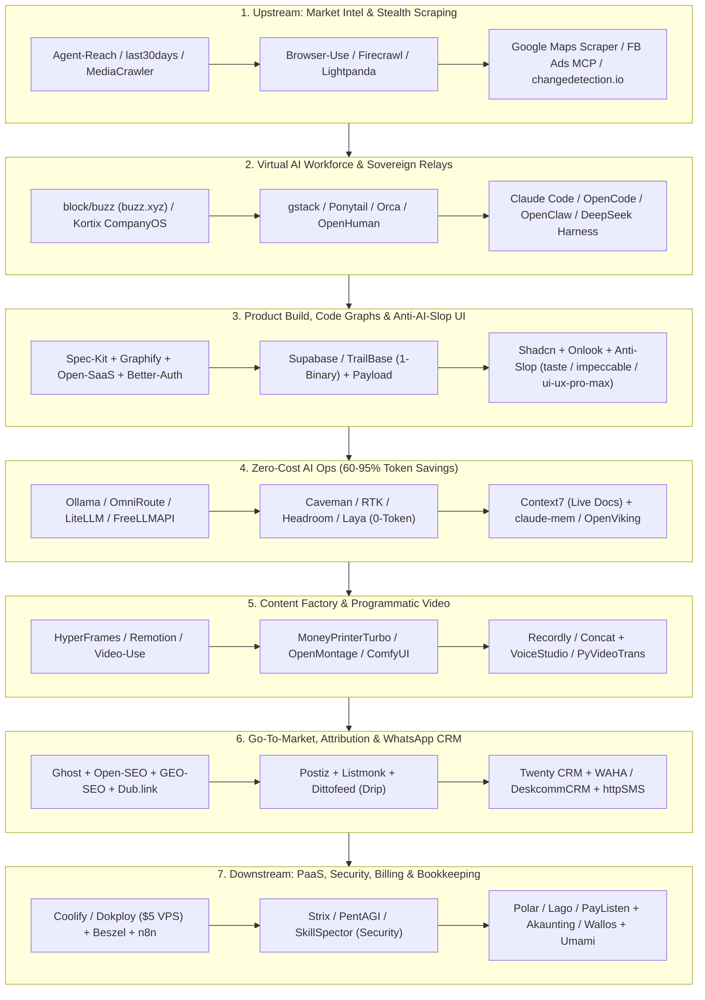

<div align="center">

# 🚀 Awesome One-Person Company (Hulu–Hilir)

**The Living, End-to-End Open-Source & Agentic AI Stack for Solopreneurs, Indie Hackers, and One-Person Companies.**

[-205_Verified-10b981?style=for-the-badge)](https://github.com/ridloabelian/awesome-one-person-company)
[](./data/verified_status.json)
[](./SKILL.md)
[](./LICENSE)

**[🌐 English](./README.md) | [🇮🇩 Bahasa Indonesia](./README.id.md) | [🪦 Stale Graveyard](./GRAVEYARD.md) | [🤖 Agent Skill (`SKILL.md`)](./SKILL.md) | [🐳 $5/mo VPS Stack](./stacks/lean-solopreneur-vps/)**

</div>

---

## ⚡ Why This Repository Exists

Most `awesome-indie` or `solopreneur` lists on GitHub suffer from three fatal flaws:
1. **Full of Abandonware:** Half the repositories haven't seen a commit since 2024.
2. **SaaS Subscription Traps:** They recommend $29–$199/mo SaaS tools that bleed solo founders dry before reaching Product-Market Fit.
3. **Missing the 2026 Agentic Stack:** They ignore **AI Agent Harnesses**, **Token Cost-Cutters (60–95% savings)**, **Anti-AI-Slop Design Skills**, and **Programmatic Video Engines**.

> [!IMPORTANT]
> **Strict 30-Day Maintenance Guarantee:** Every repository listed below is automatically audited via GitHub GraphQL API. Only repositories with active code pushes in the last **30 days** (since `2026-10-10`) survive on the main list. Stale projects are automatically moved to [GRAVEYARD.md](./GRAVEYARD.md).

---

## 🗺️ End-to-End One-Person Company Architecture (Hulu → Hilir)



---

## 📑 Table of Contents

- [1. Upstream: Market Intelligence, Trend Discovery & Stealth Scraping](#1-upstream-market-intelligence-trend-discovery-stealth-scraping) (23 active repos)
- [2. The 1-Person AI Workforce: Autonomous Agents, Harnesses & Virtual Teams](#2-the-1-person-ai-workforce-autonomous-agents-harnesses-virtual-teams) (29 active repos)
- [3. Product Development: SaaS Boilerplates, Anti-AI-Slop UI & Backend-in-a-Box](#3-product-development-saas-boilerplates-anti-ai-slop-ui-backend-in-a-box) (33 active repos)
- [4. Zero-Cost AI Ops: Token Compressors, Free AI Gateways & Agent Memory](#4-zero-cost-ai-ops-token-compressors-free-ai-gateways-agent-memory) (20 active repos)
- [5. Content Factory, Programmatic Video & Creative Suite (Organic Distribution)](#5-content-factory-programmatic-video-creative-suite-organic-distribution) (24 active repos)
- [6. Go-To-Market: SEO/GEO, Paid Ads, Social Scheduling & WhatsApp CRM](#6-go-to-market-seogeo-paid-ads-social-scheduling-whatsapp-crm) (26 active repos)
- [7. Downstream & Back-Office: Self-Hosted PaaS, Automation, Pentesting, Billing & Analytics](#7-downstream-back-office-self-hosted-paas-automation-pentesting-billing-analytics) (50 active repos)
- [💡 The Ultimate $5/mo Lean VPS Stack](#-the-ultimate-5mo-lean-vps-stack)
- [🤖 Use as an AI Agent Skill](#-use-as-an-ai-agent-skill)
- [🪦 Eliminated Stale Repositories (>30 Days Inactive)](#-eliminated-stale-repositories-30-days-inactive)

---

## 1. Upstream: Market Intelligence, Trend Discovery & Stealth Scraping

_Validate ideas before writing a single line of code. Track competitors, scrape leads, and monitor social trends without paying enterprise API fees._

| Repository | Role | Stars | Last Push | Status | Why It's Essential for a 1-Person Company |
| :--- | :--- | :---: | :---: | :---: | :--- |
| **[firecrawl/firecrawl](https://github.com/firecrawl/firecrawl)** | `Web-to-Markdown Engine` | ⭐ 200k | `2026-11-08` | 🟢 Active | Turns any website into clean, LLM-ready Markdown and structured data for competitor and market analysis. |
| **[browser-use/browser-use](https://github.com/browser-use/browser-use)** | `AI Browser Agent Framework` | ⭐ 120k | `2026-11-09` | 🟢 Active | The flagship open-source Python library and stealth browser framework that lets AI agents navigate, click, and extract data from any website. |
| **[Panniantong/Agent-Reach](https://github.com/Panniantong/Agent-Reach)** | `Multi-Platform Agent Eyes` | ⭐ 110k | `2026-11-08` | 🟢 Active | Gives AI agents eyes to read & search X/Twitter, Reddit, YouTube, GitHub, Bilibili, and XiaoHongShu without costly API keys. |
| **[D4Vinci/Scrapling](https://github.com/D4Vinci/Scrapling)** | `Adaptive Stealth Scraper` | ⭐ 100.0k | `2026-11-08` | 🟢 Active | High-performance web scraping framework with built-in MCP server that scales from single requests to full-scale stealth crawls. |
| **[koala73/worldmonitor](https://github.com/koala73/worldmonitor)** | `Real-Time Global & Macro Intel` | ⭐ 90.4k | `2026-11-08` | 🟢 Active | AI-powered situational awareness dashboard aggregating global news, market shifts, and infrastructure signals in real time. |
| **[unclecode/crawl4ai](https://github.com/unclecode/crawl4ai)** | `LLM-Ready Web Crawler` | ⭐ 87.1k | `2026-11-04` | 🟢 Active | Open-source, blazing-fast web crawler and scraper built specifically for LLMs, AI agents, and RAG pipelines. |
| **[NanmiCoder/MediaCrawler](https://github.com/NanmiCoder/MediaCrawler)** | `Social Video & Comment Crawler` | ⭐ 70.7k | `2026-11-09` | 🟢 Active | Crawls posts, videos, and user comments across TikTok/Douyin, Xiaohongshu, Bilibili, and Weibo to mine viral hooks and customer pain points. |
| **[mvanhorn/last30days-skill](https://github.com/mvanhorn/last30days-skill)** | `30-Day Trend Synthesizer` | ⭐ 67.0k | `2026-11-08` | 🟢 Active | AI agent skill that researches any topic across Reddit, X, YouTube, HackerNews, and Polymarket over the last 30 days to uncover real pain points. |
| **[DIYgod/RSSHub](https://github.com/DIYgod/RSSHub)** | `Universal RSS Generator` | ⭐ 46.9k | `2026-11-09` | 🟢 Active | Turns almost any platform (social media, changelogs, forums, e-commerce) into an automated RSS feed. |
| **[lightpanda-io/browser](https://github.com/lightpanda-io/browser)** | `Ultra-Low-RAM Headless Browser` | ⭐ 41.6k | `2026-11-09` | 🟢 Active | Headless browser written in Zig/C specifically for AI agents and automation—consumes 10x less memory than Chromium on a $5 VPS. |
| **[dgtlmoon/changedetection.io](https://github.com/dgtlmoon/changedetection.io)** | `Competitor Change Monitor` | ⭐ 35.7k | `2026-11-08` | 🟢 Active | Self-hosted monitoring tool that alerts you the moment a competitor changes pricing, landing page copy, or product availability. |
| **[CloakHQ/CloakBrowser](https://github.com/CloakHQ/CloakBrowser)** | `Anti-Detect Chromium` | ⭐ 32.8k | `2026-11-08` | 🟢 Active | Stealth Chromium with source-level fingerprint patches that passes bot detection (Cloudflare, DataDome) as a drop-in Playwright replacement. |
| **[h4ckf0r0day/obscura](https://github.com/h4ckf0r0day/obscura)** | `Stealth Agent Headless Browser` | ⭐ 30.7k | `2026-11-09` | 🟢 Active | Headless stealth browser purpose-built for AI agents and anti-bot web scraping at scale. |
| **[assafelovic/gpt-researcher](https://github.com/assafelovic/gpt-researcher)** | `Autonomous Deep Researcher` | ⭐ 30.6k | `2026-11-08` | 🟢 Active | Autonomous agent that conducts deep, citation-backed market and domain research using any LLM provider. |
| **[browserbase/stagehand](https://github.com/browserbase/stagehand)** | `AI Web Automation SDK` | ⭐ 26.0k | `2026-11-09` | 🟢 Active | Combines deterministic Playwright code with natural-language act(), extract(), and observe() primitives for resilient web scraping. |
| **[Skyvern-AI/skyvern](https://github.com/Skyvern-AI/skyvern)** | `Vision-LLM Browser Workflow Agent` | ⭐ 23.4k | `2026-11-09` | 🟢 Active | Automates complex browser workflows (form filling, invoice downloading, portal scraping) using Computer Vision and LLMs without brittle XPaths. |
| **[citrolabs/ego-lite](https://github.com/citrolabs/ego-lite)** | `Logged-In Browser Bridge for Agents` | ⭐ 22.2k | `2026-11-08` | 🟢 Active | Lets coding agents (Claude Code, Codex) safely use your already logged-in Chrome sessions for automation at zero cost and zero config. |
| **[daijro/camoufox](https://github.com/daijro/camoufox)** | `Anti-Detect Firefox` | ⭐ 13.1k | `2026-11-09` | 🟢 Active | Stealth Firefox anti-detect browser with fingerprint spoofing for uninterrupted web automation and scraping. |
| **[kaifcodec/user-scanner](https://github.com/kaifcodec/user-scanner)** | `Email & Username OSINT MCP` | ⭐ 5.6k | `2026-11-09` | 🟢 Active | 2-in-1 email and username OSINT suite with native MCP support scanning 2,700+ vectors for B2B lead enrichment and prospect verification. |
| **[KnockOutEZ/wigolo](https://github.com/KnockOutEZ/wigolo)** | `Zero-Cost Search MCP` | ⭐ 5.5k | `2026-11-08` | 🟢 Active | Local-first search, fetch, crawl, and research over MCP with $0 cost and no API keys (free alternative to Exa/Tavily). |
| **[omkarcloud/google-maps-scraper](https://github.com/omkarcloud/google-maps-scraper)** | `B2B Local Lead Scraper` | ⭐ 3.9k | `2026-11-08` | 🟢 Active | Extracts 50+ data points (business emails, phone/WhatsApp numbers, social links, reviews) from Google Maps for outbound sales. |
| **[feder-cr/invisible_playwright](https://github.com/feder-cr/invisible_playwright)** | `Zero-Captcha Playwright` | ⭐ 2.6k | `2026-11-08` | 🟢 Active | Undetected Playwright automation running stealth headless Firefox so anti-bot systems never trigger captchas. |
| **[proxy-intell/facebook-ads-library-mcp](https://github.com/proxy-intell/facebook-ads-library-mcp)** | `Meta Ad Library Spy MCP` | ⭐ 323 | `2026-11-03` | 🟢 Active | MCP server that queries the Facebook/Meta Ad Library so your AI agent can analyze competitor ad creatives, copy, and funnels. |

## 2. The 1-Person AI Workforce: Autonomous Agents, Harnesses & Virtual Teams

_Operate with the output of a 20-person startup. Use agent harnesses, specialized virtual roles, and fleet orchestrators to delegate engineering, QA, and ops._

| Repository | Role | Stars | Last Push | Status | Why It's Essential for a 1-Person Company |
| :--- | :--- | :---: | :---: | :---: | :--- |
| **[openclaw/openclaw](https://github.com/openclaw/openclaw)** | `Autonomous Personal OS Agent` | ⭐ 394k | `2026-11-09` | 🟢 Active | The personal AI agent that actually executes tasks across any OS and platform while keeping full data ownership. |
| **[mattpocock/skills](https://github.com/mattpocock/skills)** | `Production Engineering Skills` | ⭐ 319k | `2026-11-05` | 🟢 Active | Opinionated agent skills for real-world software engineering: architecture planning, strict TypeScript, TDD, and PR reviews. |
| **[obra/superpowers](https://github.com/obra/superpowers)** | `Subagent SDLC Methodology` | ⭐ 315k | `2026-11-03` | 🟢 Active | Battle-tested agentic skills framework and software development methodology for brainstorming, planning, and subagent execution. |
| **[affaan-m/ECC](https://github.com/affaan-m/ECC)** | `Agent Harness Optimizer` | ⭐ 300k | `2026-11-06` | 🟢 Active | Performance optimization system adding skills, instincts, memory, security, and research-first development to coding agents. |
| **[deepseek-ai/deepseek-harness](https://github.com/deepseek-ai/deepseek-harness)** | `Plugin-First Agent Harness` | ⭐ 277k | `2026-11-04` | 🟢 Active | DeepSeek's flagship modular agent harness ('Everything is a Plugin') for orchestrating high-efficiency autonomous coding and ops. |
| **[NousResearch/hermes-agent](https://github.com/NousResearch/hermes-agent)** | `Self-Evolving Agent Runtime` | ⭐ 262k | `2026-11-09` | 🟢 Active | Self-improving autonomous agent runtime by Nous Research with persistent memory, skills, and mobile/web workspace integrations. |
| **[anomalyco/opencode](https://github.com/anomalyco/opencode)** | `Open-Source Terminal Coding Agent` | ⭐ 226k | `2026-11-09` | 🟢 Active | The flagship open-source coding agent built for the terminal, compatible with any frontier or local LLM provider. |
| **[anthropics/skills](https://github.com/anthropics/skills)** | `Official Anthropic Agent Skills` | ⭐ 190k | `2026-11-06` | 🟢 Active | Anthropic's official public repository of reusable Agent Skills for document creation, coding workflows, and tool orchestration. |
| **[DietrichGebert/ponytail](https://github.com/DietrichGebert/ponytail)** | `Anti-Overengineering Agent Skill` | ⭐ 187k | `2026-10-29` | 🟢 Active | Makes your AI coding agent think like a pragmatic senior engineer—prevents bloated abstractions, unnecessary refactors, and over-engineering. |
| **[msitarzewski/agency-agents](https://github.com/msitarzewski/agency-agents)** | `Full-Service AI Agency` | ⭐ 167k | `2026-11-09` | 🟢 Active | A complete AI agency at your fingertips—specialized agent personas from frontend wizards to Reddit community growth ninjas. |
| **[anthropics/claude-code](https://github.com/anthropics/claude-code)** | `Terminal Agentic Engineer` | ⭐ 155k | `2026-11-06` | 🟢 Active | Anthropic's official terminal coding agent that understands full codebases, runs tests, and ships complex PRs. |
| **[garrytan/gstack](https://github.com/garrytan/gstack)** | `Virtual C-Suite & Eng Team` | ⭐ 141k | `2026-11-09` | 🟢 Active | Garry Tan's (YC CEO) exact Claude Code setup: 23 opinionated tools acting as CEO, Designer, Eng Manager, Release Manager, and QA. |
| **[openai/codex](https://github.com/openai/codex)** | `Lightweight CLI Coding Agent` | ⭐ 134k | `2026-11-09` | 🟢 Active | OpenAI's fast, lightweight terminal coding agent for rapid autonomous iteration and code review. |
| **[earendil-works/pi](https://github.com/earendil-works/pi)** | `Unified Agent Loop & CLI Toolkit` | ⭐ 121k | `2026-11-08` | 🟢 Active | High-speed AI agent toolkit featuring a unified LLM API, deterministic agent loop, TUI, and terminal coding agent CLI. |
| **[stablyai/orca](https://github.com/stablyai/orca)** | `Multi-Agent Fleet IDE` | ⭐ 119k | `2026-11-09` | 🟢 Active | Workspace for running and supervising a fleet of coding agents (Claude Code, Codex, Grok Bot, Hermes) across parallel Git worktrees. |
| **[addyosmani/agent-skills](https://github.com/addyosmani/agent-skills)** | `Web Performance & Eng Skills` | ⭐ 114k | `2026-11-01` | 🟢 Active | Addy Osmani's battle-tested production engineering skills for AI coding agents covering architecture, Core Web Vitals, and clean code. |
| **[paperclipai/paperclip](https://github.com/paperclipai/paperclip)** | `AI Workforce Governance` | ⭐ 112k | `2026-11-09` | 🟢 Active | Open-source management app to organize, govern, and track tasks across all your autonomous agents at work. |
| **[odysseus-dev/odysseus](https://github.com/odysseus-dev/odysseus)** | `Self-Hosted AI Agent Workspace` | ⭐ 95.5k | `2026-11-09` | 🟢 Active | Self-hosted AI workspace for orchestrating autonomous agents, local tools, and long-running workflows. |
| **[OpenHands/OpenHands](https://github.com/OpenHands/OpenHands)** | `Autonomous AI Software Developer` | ⭐ 93.0k | `2026-11-09` | 🟢 Active | Full-featured autonomous development platform with sandboxed browser, terminal, and code editor. |
| **[bytedance/deer-flow](https://github.com/bytedance/deer-flow)** | `Long-Horizon SuperAgent Harness` | ⭐ 85.2k | `2026-11-09` | 🟢 Active | Open-source SuperAgent harness with sandboxes, memory, subagents, and message gateways that executes multi-hour research and coding tasks. |
| **[ruvnet/ruflo](https://github.com/ruvnet/ruflo)** | `Multi-Agent Swarm Coordinator` | ⭐ 81.3k | `2026-11-09` | 🟢 Active | Deploys intelligent multi-agent swarms with adaptive memory, vector RAG, and native Claude Code, Codex, and Hermes integration. |
| **[cline/cline](https://github.com/cline/cline)** | `IDE & CLI Autonomous Agent` | ⭐ 71.5k | `2026-11-07` | 🟢 Active | Autonomous coding agent available as an IDE extension, CLI assistant, and SDK with granular tool-use approval. |
| **[multica-ai/multica](https://github.com/multica-ai/multica)** | `Human + AI Team Workspace` | ⭐ 55.3k | `2026-11-09` | 🟢 Active | Self-hostable workspace designed to make humans and autonomous AI agents collaborate as one unified team. |
| **[tinyhumansai/openhuman](https://github.com/tinyhumansai/openhuman)** | `500-Agent-on-$10-VPS Harness` | ⭐ 42.6k | `2026-11-08` | 🟢 Active | Ultra-lightweight, resource-efficient open-source agent harness engineered to run 500+ concurrent agents on a single $10 VPS. |
| **[block/buzz](https://github.com/block/buzz)** | `Sovereign Human + Agent Relay (buzz.xyz)` | ⭐ 36.8k | `2026-11-09` | 🟢 Active | Block's self-hostable Nostr relay workspace where humans and AI agents share rooms, open Git repos, send patches, run CI, edit canvases, and join voice huddles with cryptographic audit trails. |
| **[iOfficeAI/AionUi](https://github.com/iOfficeAI/AionUi)** | `24/7 Multi-CLI Cowork Desktop` | ⭐ 34.1k | `2026-11-05` | 🟢 Active | Open-source 24/7 Cowork app that unifies OpenClaw, Hermes, Claude Code, Codex, OpenCode, and 20+ CLI agents into one visual team. |
| **[different-ai/openwork](https://github.com/different-ai/openwork)** | `Open-Source Claude Cowork` | ⭐ 24.5k | `2026-11-08` | 🟢 Active | Open-source alternative to Claude Cowork (powered by OpenCode) for delegating everyday business, file, and browser tasks. |
| **[getpaseo/paseo](https://github.com/getpaseo/paseo)** | `Desktop & Mobile Agent Commander` | ⭐ 23.6k | `2026-11-09` | 🟢 Active | Orchestrate, monitor, and approve multiple coding agents simultaneously from both your desktop and mobile phone. |
| **[kortix-ai/CompanyOS](https://github.com/kortix-ai/CompanyOS)** | `Open-Source CompanyOS` | ⭐ 20.6k | `2026-11-09` | 🟢 Active | Kortix CompanyOS: open-source operating system to run your company as code with multiplayer AI agents and sovereign browser/terminal sandboxes. |

## 3. Product Development: SaaS Boilerplates, Anti-AI-Slop UI & Backend-in-a-Box

_Never build auth, billing, or basic UI from scratch. Combine full-stack starters with anti-slop design skills so your solo product looks like a Series-A unicorn._

| Repository | Role | Stars | Last Push | Status | Why It's Essential for a 1-Person Company |
| :--- | :--- | :---: | :---: | :---: | :--- |
| **[github/spec-kit](https://github.com/github/spec-kit)** | `Spec-Driven Development Toolkit` | ⭐ 149k | `2026-11-07` | 🟢 Active | GitHub's official toolkit for Spec-Driven Development—aligns coding agents on crystal-clear specifications before a single line of code is written. |
| **[nextlevelbuilder/ui-ux-pro-max-skill](https://github.com/nextlevelbuilder/ui-ux-pro-max-skill)** | `UI/UX Design Intelligence Skill` | ⭐ 147k | `2026-11-07` | 🟢 Active | Provides deep design intelligence for coding agents to build polished web and mobile interfaces across frameworks. |
| **[Graphify-Labs/graphify](https://github.com/Graphify-Labs/graphify)** | `Deterministic Codebase Knowledge Graph` | ⭐ 145k | `2026-11-08` | 🟢 Active | Turns your codebase, SQL schemas, configs, and PDFs into a deterministic AST knowledge graph for Claude Code, Cursor, and Codex without vector stores. |
| **[shadcn-ui/ui](https://github.com/shadcn-ui/ui)** | `Composable UI Primitives` | ⭐ 128k | `2026-11-08` | 🟢 Active | Accessible, customizable components you copy-paste directly into your codebase with zero lock-in. |
| **[supabase/supabase](https://github.com/supabase/supabase)** | `Postgres + pgvector Backend` | ⭐ 115k | `2026-11-09` | 🟢 Active | Open-source Firebase alternative providing Postgres, Auth, instant APIs, Storage, Edge Functions, and vector embeddings. |
| **[Leonxlnx/taste-skill](https://github.com/Leonxlnx/taste-skill)** | `Art Direction & Taste Skill` | ⭐ 112k | `2026-11-08` | 🟢 Active | Gives coding agents visual taste using reference-driven art direction and live browser checks instead of generic AI layouts. |
| **[nexu-io/open-design](https://github.com/nexu-io/open-design)** | `AI Design Agent Workspace` | ⭐ 107k | `2026-11-09` | 🟢 Active | Local-first collaborative AI design workspace for creating prototypes, motion, websites, and design systems. |
| **[pbakaus/impeccable](https://github.com/pbakaus/impeccable)** | `UI Polish & Critique Vocabulary` | ⭐ 106k | `2026-11-09` | 🟢 Active | Design vocabulary for coding agents to audit, critique, and polish interfaces while catching AI slop. |
| **[tt-a1i/archify](https://github.com/tt-a1i/archify)** | `Interactive Architecture Diagram Skill` | ⭐ 94.8k | `2026-11-08` | 🟢 Active | Agent skill that turns any product idea, implementation plan, or existing repo into beautiful interactive architecture diagrams. |
| **[abi/screenshot-to-code](https://github.com/abi/screenshot-to-code)** | `Screenshot-to-Code Converter` | ⭐ 81.1k | `2026-11-05` | 🟢 Active | Drop in any screenshot or screen recording and convert it into clean HTML, Tailwind, React, or Vue code. |
| **[cathrynlavery/diagram-design](https://github.com/cathrynlavery/diagram-design)** | `Editorial Anti-Slop Diagram Skill` | ⭐ 65.9k | `2026-11-09` | 🟢 Active | Generates 45 types of self-contained, editorial-grade HTML + SVG diagrams for pitch decks, docs, and landing pages with zero Mermaid slop. |
| **[penpot/penpot](https://github.com/penpot/penpot)** | `Open-Source Design Platform` | ⭐ 62.2k | `2026-11-08` | 🟢 Active | Open-source alternative to Figma with native CSS Grid, Flexbox, and design-token support. |
| **[appwrite/appwrite](https://github.com/appwrite/appwrite)** | `All-in-One Backend Cloud` | ⭐ 57.9k | `2026-11-09` | 🟢 Active | Self-hostable backend server offering Auth, Databases, Storage, Functions, Messaging, and Realtime out of the box. |
| **[ChromeDevTools/chrome-devtools-mcp](https://github.com/ChromeDevTools/chrome-devtools-mcp)** | `Official Chrome DevTools MCP` | ⭐ 55.0k | `2026-11-08` | 🟢 Active | Gives coding agents live access to Chrome DevTools to inspect DOM layout, debug console errors, and audit Core Web Vitals autonomously. |
| **[Nutlope/hallmark](https://github.com/Nutlope/hallmark)** | `Anti-AI-Slop Frontend Skill` | ⭐ 51.1k | `2026-11-05` | 🟢 Active | Anti-AI-slop design skill tailored for Claude Code, Cursor, and Codex. |
| **[alibaba/open-code-review](https://github.com/alibaba/open-code-review)** | `Hybrid Deterministic + AI Code Reviewer` | ⭐ 49.7k | `2026-11-06` | 🟢 Active | Combines static analysis pipelines with LLM agents to catch SQL injection, XSS, race conditions, and logic bugs at the line level before deploy. |
| **[DeusData/codebase-memory-mcp](https://github.com/DeusData/codebase-memory-mcp)** | `Persistent Code Graph & Test Selector` | ⭐ 48.4k | `2026-11-07` | 🟢 Active | Connects code, docs, and infra in a persistent local graph over MCP with change-aware test selection for rapid solo shipping. |
| **[payloadcms/payload](https://github.com/payloadcms/payload)** | `Next.js-Native Headless CMS & App Framework` | ⭐ 45.7k | `2026-11-07` | 🟢 Active | Full-stack TypeScript headless CMS and admin panel that installs directly inside your Next.js app folder with zero external server overhead. |
| **[JCodesMore/ai-website-cloner-template](https://github.com/JCodesMore/ai-website-cloner-template)** | `1-Command Website Cloner` | ⭐ 38.9k | `2026-10-19` | 🟢 Active | Clone the layout and visual architecture of any reference website with one command using AI coding agents. |
| **[directus/directus](https://github.com/directus/directus)** | `Instant SQL-to-API & Admin Studio` | ⭐ 38.7k | `2026-11-07` | 🟢 Active | Wraps any SQL database with instant REST/GraphQL APIs, granular auth, file storage, and a no-code admin dashboard for clients. |
| **[CopilotKit/CopilotKit](https://github.com/CopilotKit/CopilotKit)** | `In-App AI Copilot & Generative UI Stack` | ⭐ 38.6k | `2026-11-08` | 🟢 Active | The standard frontend framework and AG-UI protocol to embed interactive AI copilots and Generative UI directly inside your SaaS product. |
| **[medusajs/medusa](https://github.com/medusajs/medusa)** | `Open-Source Composable Shopify` | ⭐ 37.1k | `2026-11-09` | 🟢 Active | Flexible TypeScript commerce platform for building custom digital/physical storefronts, subscriptions, and multi-region marketplaces without Shopify fees. |
| **[better-auth/better-auth](https://github.com/better-auth/better-auth)** | `Modern TypeScript Auth Framework` | ⭐ 30.7k | `2026-11-09` | 🟢 Active | The most comprehensive TypeScript auth library with built-in plugins for multi-tenancy/organizations, 2FA, passkeys, and Stripe/Polar billing. |
| **[google-labs-code/design.md](https://github.com/google-labs-code/design.md)** | `Agent Design System Specification` | ⭐ 28.8k | `2026-11-06` | 🟢 Active | Google Labs' DESIGN.md standard that gives coding agents a persistent, structured blueprint of your brand's typography, colors, and layout rules. |
| **[onlook-dev/onlook](https://github.com/onlook-dev/onlook)** | `Visual React/Tailwind Code Editor` | ⭐ 27.1k | `2026-10-21` | 🟢 Active | Visually inspect, drag, and style your live React and Tailwind CSS app in a Figma-like canvas that writes clean diffs straight back to your code. |
| **[magicuidesign/magicui](https://github.com/magicuidesign/magicui)** | `High-Conversion Landing UI` | ⭐ 23.2k | `2026-11-08` | 🟢 Active | Animated bento grids, marquees, and interactive effects built to make indie landing pages convert. |
| **[dyad-sh/dyad](https://github.com/dyad-sh/dyad)** | `Local Open-Source Lovable / v0 / Bolt` | ⭐ 22.2k | `2026-11-06` | 🟢 Active | Local-first, open-source AI app builder for power users to prompt, preview, and ship full-stack apps without paying $20–$50/mo platform credits. |
| **[wasp-lang/open-saas](https://github.com/wasp-lang/open-saas)** | `Full-Stack SaaS Boilerplate` | ⭐ 16.3k | `2026-11-06` | 🟢 Active | 100% free, open-source SaaS starter (React, Node.js, Prisma, Stripe/LemonSqueezy, Auth, Admin UI, OpenAI examples). |
| **[fuma-nama/fumadocs](https://github.com/fuma-nama/fumadocs)** | `Next.js Product Documentation Engine` | ⭐ 13.6k | `2026-11-08` | 🟢 Active | Beautiful, blazing-fast React/Next.js documentation framework with OpenAPI playground and AI search—replaces $150/mo Mintlify subscriptions. |
| **[InsForge/InsForge](https://github.com/InsForge/InsForge)** | `Agent-Native Backend Platform` | ⭐ 13.3k | `2026-11-08` | 🟢 Active | Open-source backend platform purpose-built to give coding agents instant database, auth, storage, and vector primitives. |
| **[miqdadbadjuber/anti-slop](https://github.com/miqdadbadjuber/anti-slop)** | `Strict Anti-Slop Ruleset` | ⭐ 8.7k | `2026-11-08` | 🟢 Active | Ruleset that filters out generic AI-generated UI designs, robotic copywriting, and bloated code patterns. |
| **[ixartz/SaaS-Boilerplate](https://github.com/ixartz/SaaS-Boilerplate)** | `Next.js Multi-Tenant Starter` | ⭐ 7.5k | `2026-11-01` | 🟢 Active | Full-stack Next.js + Tailwind CSS + Shadcn UI + Drizzle ORM boilerplate with built-in multi-tenancy and auth. |
| **[trailbaseio/trailbase](https://github.com/trailbaseio/trailbase)** | `1-Binary Rust/SQLite Backend + MCP` | ⭐ 5.8k | `2026-11-08` | 🟢 Active | Active replacement for archived PocketBase: sub-millisecond single-executable Rust + SQLite + Wasmtime backend with type-safe APIs, Auth, Admin UI, and native MCP. |

## 4. Zero-Cost AI Ops: Token Compressors, Free AI Gateways & Agent Memory

_Protect your solo profit margins. Slash LLM token consumption by 60–95%, unify free-tier APIs with automatic failover, and persist agent memory across sessions._

| Repository | Role | Stars | Last Push | Status | Why It's Essential for a 1-Person Company |
| :--- | :--- | :---: | :---: | :---: | :--- |
| **[ollama/ollama](https://github.com/ollama/ollama)** | `Local LLM Runtime Engine` | ⭐ 186k | `2026-11-08` | 🟢 Active | Run DeepSeek, Qwen, GLM, Kimi, and Gemma locally on your laptop or server with one command at $0 per token. |
| **[JuliusBrussee/caveman](https://github.com/JuliusBrussee/caveman)** | `65% Output Token Cutter` | ⭐ 118k | `2026-11-09` | 🟢 Active | Skill and proxy that slashes 65% of token usage by making coding agents communicate concisely without fluff. |
| **[thedotmack/claude-mem](https://github.com/thedotmack/claude-mem)** | `Cross-Session Agent Memory` | ⭐ 115k | `2026-11-09` | 🟢 Active | Captures everything your coding agent does during sessions, compresses it, and injects relevant context into future runs. |
| **[rtk-ai/rtk](https://github.com/rtk-ai/rtk)** | `CLI Dev-Command Token Proxy` | ⭐ 85.9k | `2026-11-08` | 🟢 Active | Single Rust binary CLI proxy that reduces LLM token consumption by 60–90% on common developer commands. |
| **[cheaper-inference/OmniRoute](https://github.com/cheaper-inference/OmniRoute)** | `375-Provider Free/Paid AI Gateway` | ⭐ 85.7k | `2026-11-09` | 🟢 Active | MIT-licensed AI gateway routing across 375 providers (including 150+ free tiers) and 1,400+ models behind one endpoint. |
| **[headroomlabs-ai/headroom](https://github.com/headroomlabs-ai/headroom)** | `Tool & RAG Context Compressor` | ⭐ 79.2k | `2026-11-08` | 🟢 Active | Compresses noisy tool outputs, logs, files, and RAG chunks before they reach the LLM, cutting 60–95% of context tokens. |
| **[mem0ai/mem0](https://github.com/mem0ai/mem0)** | `Production AI Memory Layer` | ⭐ 68.7k | `2026-11-06` | 🟢 Active | Drop-in memory infrastructure so your customer-facing AI agents remember user preferences and history. |
| **[Alishahryar1/free-claude-code](https://github.com/Alishahryar1/free-claude-code)** | `Multi-Harness Free Token Hub` | ⭐ 67.4k | `2026-11-08` | 🟢 Active | Connects Claude Code, Codex, Antigravity, VSCode, Pi, and OpenCode to 1.3B+ free tokens across terminal, IDE, browser, and mobile. |
| **[upstash/context7](https://github.com/upstash/context7)** | `Up-to-Date Docs MCP (Anti-Hallucination)` | ⭐ 64.4k | `2026-11-06` | 🟢 Active | Injects real-time, version-specific documentation directly into your coding agent so you never waste tokens debugging hallucinated or deprecated APIs. |
| **[BerriAI/litellm](https://github.com/BerriAI/litellm)** | `Unified LLM Proxy & Budget Guard` | ⭐ 62.9k | `2026-11-09` | 🟢 Active | High-speed Rust/Python AI gateway to call 100+ LLM APIs in OpenAI format with strict cost tracking and budget limits. |
| **[router-for-me/CLIProxyAPI](https://github.com/router-for-me/CLIProxyAPI)** | `CLI Subscription-to-API Bridge` | ⭐ 58.0k | `2026-11-09` | 🟢 Active | Wraps your existing CLI tools (Antigravity, Claude Code, ChatGPT Codex, Devin) into a local OpenAI/Claude-compatible API. |
| **[tashfeenahmed/freellmapi](https://github.com/tashfeenahmed/freellmapi)** | `34-Provider Free LLM Aggregator` | ⭐ 49.3k | `2026-11-08` | 🟢 Active | Unifies 34 free LLM providers and 635 free model endpoints behind one OpenAI-compatible /v1 endpoint with smart routing and auto-failover. |
| **[volcengine/OpenViking](https://github.com/volcengine/OpenViking)** | `Self-Evolving Context & Memory DB` | ⭐ 41.8k | `2026-11-09` | 🟢 Active | Self-evolving context database for AI agents that unifies long-term agent memory, knowledge RAG, and reusable skills. |
| **[NandhaKishorM/laya](https://github.com/NandhaKishorM/laya)** | `0-Output-Token System-1 Decision Engine` | ⭐ 35.2k | `2026-11-08` | 🟢 Active | Non-autoregressive System-1 model that returns calibrated yes/no, choice, and scoring decisions in a single ~10ms forward pass with zero output token decoding. |
| **[mksglu/context-mode](https://github.com/mksglu/context-mode)** | `Context Window Sandbox` | ⭐ 33.7k | `2026-11-09` | 🟢 Active | Sandboxes heavy tool output (up to 98% token reduction) and persists session memory across coding agents. |
| **[lbjlaq/Antigravity-Manager](https://github.com/lbjlaq/Antigravity-Manager)** | `1-Click Antigravity Account Switcher` | ⭐ 32.9k | `2026-11-08` | 🟢 Active | Fast Rust + Tauri desktop utility for seamless one-click account management and quota switching across Antigravity tools. |
| **[yetone/magpie](https://github.com/yetone/magpie)** | `Menu-Bar Agent Model Switcher` | ⭐ 32.5k | `2026-11-09` | 🟢 Active | Lets you pair any coding agent with any model from your menu bar—run Codex on DeepSeek or Claude Code on Kimi/Gemini effortlessly. |
| **[decolua/9router](https://github.com/decolua/9router)** | `Multi-Tool Free AI Router` | ⭐ 32.1k | `2026-11-09` | 🟢 Active | Connects Claude Code, Codex, Cursor, Cline, and Antigravity to free-tier and fallback LLM providers seamlessly. |
| **[rohitg00/agentmemory](https://github.com/rohitg00/agentmemory)** | `Benchmark-#1 Coding Agent Memory` | ⭐ 30.2k | `2026-11-08` | 🟢 Active | High-accuracy persistent memory engine for AI coding agents so architectural decisions and bug fixes are never forgotten across sessions. |
| **[weave-os/router](https://github.com/weave-os/router)** | `Sub-50ms Cost-Saving Prompt Router` | ⭐ 5.6k | `2026-11-09` | 🟢 Active | Evaluates and routes every agent prompt to the most cost-effective capable model in under 50ms, slashing API bills by 40–70%. |

## 5. Content Factory, Programmatic Video & Creative Suite (Organic Distribution)

_Distribution is the hardest part of solo bisnis. Automate short-form video production, programmatic launch reels, studio screen recordings, and local voice cloning._

| Repository | Role | Stars | Last Push | Status | Why It's Essential for a 1-Person Company |
| :--- | :--- | :---: | :---: | :---: | :--- |
| **[yt-dlp/yt-dlp](https://github.com/yt-dlp/yt-dlp)** | `Universal Media Ingestion CLI` | ⭐ 206k | `2026-11-04` | 🟢 Active | The backbone CLI for downloading reference videos, podcasts, and competitor reels from 1,000+ sites into your local AI clipping/repurposing pipelines. |
| **[Comfy-Org/ComfyUI](https://github.com/Comfy-Org/ComfyUI)** | `Node-Based Local Diffusion Studio` | ⭐ 146k | `2026-11-09` | 🟢 Active | The fastest modular diffusion GUI and backend for generating product mockups, YouTube thumbnails, consistent brand characters, and local AI video. |
| **[harry0703/MoneyPrinterTurbo](https://github.com/harry0703/MoneyPrinterTurbo)** | `Automated Short-Video Generator` | ⭐ 141k | `2026-11-07` | 🟢 Active | Generates HD short videos for TikTok, Reels, and YouTube Shorts automatically from a single topic or keyword. |
| **[debpalash/VoiceStudio](https://github.com/debpalash/VoiceStudio)** | `Local ElevenLabs Alternative` | ⭐ 105k | `2026-11-08` | 🟢 Active | Fully local voice cloning, voice design, video dubbing, and TTS studio running on your own hardware at $0 per character. |
| **[heygen-com/hyperframes](https://github.com/heygen-com/hyperframes)** | `HTML-to-Video Engine for Agents` | ⭐ 81.2k | `2026-11-09` | 🟢 Active | Write standard HTML/CSS/GSAP and render broadcast-grade motion graphics videos—designed specifically for AI coding agents. |
| **[OpenMontageInc/OpenMontage](https://github.com/OpenMontageInc/OpenMontage)** | `Agentic Video Production Studio` | ⭐ 78.7k | `2026-11-08` | 🟢 Active | Open-source agentic video production system featuring 12 production pipelines and 100+ tools from script to render. |
| **[storytold/photocraft](https://github.com/storytold/photocraft)** | `Pure-Rust Photoshop Alternative` | ⭐ 78.0k | `2026-11-09` | 🟢 Active | Blazing-fast open-source photo editor written from scratch in pure Rust (part of the Craft creative suite). |
| **[hugohe3/ppt-master](https://github.com/hugohe3/ppt-master)** | `AI Native PowerPoint Generator` | ⭐ 75.0k | `2026-11-08` | 🟢 Active | Turns documents or topics into real, native PowerPoint decks with editable shapes, charts, and transitions. |
| **[remotion-dev/remotion](https://github.com/remotion-dev/remotion)** | `Programmatic React Video` | ⭐ 71.8k | `2026-11-08` | 🟢 Active | Create programmatic product launch videos, personalized user recaps, and dynamic social videos using React. |
| **[OpenBMB/VoxCPM](https://github.com/OpenBMB/VoxCPM)** | `Tokenizer-Free Multilingual Voice Cloning` | ⭐ 41.8k | `2026-11-05` | 🟢 Active | VoxCPM2 delivers lifelike multilingual speech generation, emotional voice design, and zero-shot voice cloning on local hardware. |
| **[storytold/artcraft](https://github.com/storytold/artcraft)** | `Pure-Rust Adobe Creative Cloud Suite` | ⭐ 40.0k | `2026-11-09` | 🟢 Active | The umbrella engine behind FilmCraft (Premiere), VectorCraft (Illustrator), EffectCraft (After Effects), LightCraft (Lightroom), and WordCraft. |
| **[webadderallorg/Recordly](https://github.com/webadderallorg/Recordly)** | `Open-Source Screen Studio` | ⭐ 36.4k | `2026-11-09` | 🟢 Active | Creates polished product demo videos with smooth automatic cursor zoom and backgrounds on Mac, Windows, and Linux. |
| **[Anil-matcha/Open-Generative-AI](https://github.com/Anil-matcha/Open-Generative-AI)** | `Self-Hosted 600-Model Media Studio` | ⭐ 33.4k | `2026-11-08` | 🟢 Active | Open-source, self-hosted AI image and video generation workspace supporting Flux, Kling, Sora, Veo, and Wan in one unified UI. |
| **[hypit-ai/hypit](https://github.com/hypit-ai/hypit)** | `Viral Video Format Cloner` | ⭐ 28.7k | `2026-11-05` | 🟢 Active | Clones any viral video workflow end-to-end with AI agents—script adaptation, B-roll replacement, and automated editing. |
| **[guillaumemeyer/watermarks-remover](https://github.com/guillaumemeyer/watermarks-remover)** | `Local AI Asset Watermark Cleaner` | ⭐ 26.8k | `2026-11-02` | 🟢 Active | Privacy-first local application that cleanly removes watermarks from visual assets and drafts that you own. |
| **[CapSoftware/Cap](https://github.com/CapSoftware/Cap)** | `Open-Source Loom Alternative` | ⭐ 24.7k | `2026-11-09` | 🟢 Active | Beautiful, instant shareable screen recordings for async product demos, onboarding, and customer support. |
| **[jianchang512/pyvideotrans](https://github.com/jianchang512/pyvideotrans)** | `Global Video Translator & Dubber` | ⭐ 19.7k | `2026-11-09` | 🟢 Active | Translates videos into any language with automatic speech recognition, translated subtitles, and voice-cloned audio dubbing to reach global markets. |
| **[Vincentwei1021/video-shotcraft](https://github.com/Vincentwei1021/video-shotcraft)** | `124-Recipe Remotion Promo Skill` | ⭐ 18.0k | `2026-10-29` | 🟢 Active | Claude Code & Codex skill featuring 124 shot recipe cards, beat sync, and sound design to generate cinematic product promo videos with Remotion. |
| **[chatfire-AI/huobao-drama](https://github.com/chatfire-AI/huobao-drama)** | `1-Prompt Short Drama & Story Studio` | ⭐ 17.1k | `2026-11-05` | 🟢 Active | End-to-end AI video platform that turns a single sentence or product story into a complete multi-shot short drama from script to final render. |
| **[jub0t/Concat](https://github.com/jub0t/Concat)** | `Scriptable Open-Source CapCut + MCP` | ⭐ 15.8k | `2026-11-08` | 🟢 Active | Free, local-first, cross-platform CapCut replacement that can be used manually or automated by AI agents via JSON-RPC API and MCP. |
| **[krillinai/OpenCreator](https://github.com/krillinai/OpenCreator)** | `All-in-One AI Creator Workspace` | ⭐ 14.2k | `2026-11-08` | 🟢 Active | Unified creator workspace for video downloading, multilingual dubbing, avatar generation, and agent-assisted social media editing. |
| **[presenton/presenton](https://github.com/presenton/presenton)** | `Open-Source Gamma / Canva Decks + API` | ⭐ 11.8k | `2026-11-06` | 🟢 Active | Self-hosted AI presentation generator and REST API to automate sales decks, client reports, and carousel slides (Gamma/Beautiful.ai replacement). |
| **[zhouxiaoka/autoclip](https://github.com/zhouxiaoka/autoclip)** | `1-Click Podcast/Video Clipper` | ⭐ 10.1k | `2026-11-09` | 🟢 Active | Desktop AI video clipper that slices podcasts and talks into short clips with auto-generated subtitles, covers, and social copy. |
| **[mutonby/openshorts](https://github.com/mutonby/openshorts)** | `Open-Source Opus Clip Alternative` | ⭐ 7.6k | `2026-11-08` | 🟢 Active | Turns long-form videos into viral 9:16 shorts with AI moment detection, active speaker face tracking, and animated captions. |

## 6. Go-To-Market: SEO/GEO, Paid Ads, Social Scheduling & WhatsApp CRM

_Acquire customers across search engines, AI answer engines (ChatGPT/Perplexity), paid ads, social media, email newsletters, and automated WhatsApp pipelines._

| Repository | Role | Stars | Last Push | Status | Why It's Essential for a 1-Person Company |
| :--- | :--- | :---: | :---: | :---: | :--- |
| **[blader/humanizer](https://github.com/blader/humanizer)** | `AI Copywriting De-Slopper` | ⭐ 66.6k | `2026-10-28` | 🟢 Active | Agent skill that strips robotic phrasing and signs of AI-generated writing from blog posts, cold emails, and social threads. |
| **[twentyhq/twenty](https://github.com/twentyhq/twenty)** | `AI-Native Open-Source CRM` | ⭐ 60.7k | `2026-11-09` | 🟢 Active | Modern, customizable open-source CRM alternative to Salesforce, HubSpot, and Attio for managing B2B pipelines. |
| **[coreyhaines31/marketingskills](https://github.com/coreyhaines31/marketingskills)** | `CRO, Copywriting & Growth Skills` | ⭐ 59.3k | `2026-11-06` | 🟢 Active | Equips your AI agent with proven frameworks for Conversion Rate Optimization (CRO), landing page copy, SEO, and growth loops. |
| **[TryGhost/Ghost](https://github.com/TryGhost/Ghost)** | `SEO Publishing, Newsletter & Memberships` | ⭐ 55.7k | `2026-11-09` | 🟢 Active | The gold-standard open-source platform for SEO content marketing, email newsletters, and paid subscriber communities (Substack/Medium alternative). |
| **[calcom/cal.diy](https://github.com/calcom/cal.diy)** | `Self-Hosted Scheduling Infra` | ⭐ 49.8k | `2026-11-03` | 🟢 Active | Open-source Calendly replacement for discovery calls, paid consultations, and automated calendar routing. |
| **[gitroomhq/postiz-app](https://github.com/gitroomhq/postiz-app)** | `Agentic Social Media Scheduler` | ⭐ 41.2k | `2026-11-09` | 🟢 Active | All-in-one social media scheduling, AI content writer, and analytics tool for X, LinkedIn, Instagram, TikTok, Reddit, and Threads. |
| **[novuhq/novu](https://github.com/novuhq/novu)** | `Omni-Channel Notification Infrastructure` | ⭐ 40.3k | `2026-11-08` | 🟢 Active | Open-source notification engine to orchestrate in-app inbox alerts, transactional emails, push notifications, and SMS across your product. |
| **[AgriciDaniel/claude-seo](https://github.com/AgriciDaniel/claude-seo)** | `26-Skill Technical SEO Suite` | ⭐ 27.5k | `2026-11-01` | 🟢 Active | Comprehensive SEO suite with 26 sub-skills and 19 sub-agents covering technical SEO, E-E-A-T, schema markup, and content audits. |
| **[every-app/open-seo](https://github.com/every-app/open-seo)** | `Open-Source Semrush & Ahrefs` | ⭐ 26.9k | `2026-11-07` | 🟢 Active | Keyword research, backlink analysis, technical site audits, and Google Search Console MCP integration without the $130/mo fee. |
| **[dubinc/dub.link](https://github.com/dubinc/dub.link)** | `Link Attribution & Affiliate Engine` | ⭐ 25.1k | `2026-10-27` | 🟢 Active | Modern link attribution platform that tracks exactly which social post, campaign, or affiliate link converts into signups and paying customers. |
| **[knadh/listmonk](https://github.com/knadh/listmonk)** | `Single-Binary Newsletter Engine` | ⭐ 24.2k | `2026-11-07` | 🟢 Active | High-performance self-hosted newsletter and mailing list manager in a single Go binary—pair with AWS SES to send 10k emails for $1. |
| **[resend/react-email](https://github.com/resend/react-email)** | `React Transactional Emails` | ⭐ 19.9k | `2026-11-06` | 🟢 Active | Build dark-mode-ready, responsive transactional and onboarding emails using modern React components. |
| **[postalserver/postal](https://github.com/postalserver/postal)** | `Self-Hosted SendGrid / Mailgun` | ⭐ 16.9k | `2026-11-04` | 🟢 Active | Full-featured open-source mail delivery platform for sending high-volume transactional and marketing emails from your own infrastructure. |
| **[rmyndharis/OpenWA](https://github.com/rmyndharis/OpenWA)** | `Self-Hosted WhatsApp Gateway` | ⭐ 16.6k | `2026-11-08` | 🟢 Active | Free, self-hosted WhatsApp API gateway for automated order alerts, OTPs, and conversational customer bots. |
| **[zubair-trabzada/geo-seo-claude](https://github.com/zubair-trabzada/geo-seo-claude)** | `Generative Engine Optimization (GEO)` | ⭐ 11.6k | `2026-11-08` | 🟢 Active | Optimizes your website's citability and structure so ChatGPT, Perplexity, and Google AI Overviews recommend your product. |
| **[AgriciDaniel/claude-ads](https://github.com/AgriciDaniel/claude-ads)** | `12-Platform Paid Ads Manager` | ⭐ 10.9k | `2026-11-01` | 🟢 Active | Paid-media operations skill across Google, Meta, YouTube, LinkedIn, and TikTok ads for campaign audits and ROAS optimization. |
| **[growthbook/growthbook](https://github.com/growthbook/growthbook)** | `Feature Flags & A/B Testing Suite` | ⭐ 8.6k | `2026-11-09` | 🟢 Active | Run scientific A/B tests on your landing page headlines, onboarding flows, and pricing tiers to maximize conversion rates. |
| **[devlikeapro/waha](https://github.com/devlikeapro/waha)** | `WhatsApp HTTP API + MCP` | ⭐ 7.8k | `2026-11-06` | 🟢 Active | One-click self-hosted WhatsApp HTTP REST API supporting multiple engines and native MCP server integration. |
| **[irinabuht12-oss/google-ads-meta-ads-mcp](https://github.com/irinabuht12-oss/google-ads-meta-ads-mcp)** | `Unified Ads & Analytics MCP` | ⭐ 7.1k | `2026-10-27` | 🟢 Active | Connects Google Ads, Meta Ads (Facebook/IG), GA4, and Search Console directly to Claude, Cursor, or n8n. |
| **[NdoleStudio/httpsms](https://github.com/NdoleStudio/httpsms)** | `Zero-Fee Android HTTP SMS Gateway` | ⭐ 6.3k | `2026-11-07` | 🟢 Active | Turns your spare Android phone into a programmatic HTTP SMS gateway—send OTPs, booking reminders, and alerts using your local SIM plan instead of Twilio. |
| **[melgarafael/DeskcommCRM](https://github.com/melgarafael/DeskcommCRM)** | `WhatsApp AI Sales CRM` | ⭐ 5.3k | `2026-11-08` | 🟢 Active | Open-source AI sales OS combining a self-hosted multi-channel CRM with native AI agents and WhatsApp automation. |
| **[darkzOGx/youtube-automation-agent](https://github.com/darkzOGx/youtube-automation-agent)** | `Autonomous YouTube Channel Operator` | ⭐ 5.1k | `2026-10-27` | 🟢 Active | Self-hosted AI agent that runs a YouTube channel end-to-end: topic research, scriptwriting, voiceover, video rendering, SEO metadata, and publishing. |
| **[nowork-studio/notfair-plugin](https://github.com/nowork-studio/notfair-plugin)** | `Agentic SEO, GEO & Growth Plugin` | ⭐ 4.1k | `2026-11-06` | 🟢 Active | Equips coding agents with actionable SEO, Generative Engine Optimization (GEO), and technical growth marketing workflows. |
| **[dittofeed/dittofeed](https://github.com/dittofeed/dittofeed)** | `Behavioral Drip & Onboarding Automation` | ⭐ 3.1k | `2026-10-12` | 🟢 Active | Open-source customer engagement platform (Customer.io / Loops alternative) to trigger behavioral onboarding emails, trial nudges, and churn win-backs. |
| **[ArnasDon/wacrm](https://github.com/ArnasDon/wacrm)** | `Self-Hostable WhatsApp Pipeline CRM` | ⭐ 2.7k | `2026-11-02` | 🟢 Active | Ready-to-fork WhatsApp CRM featuring a shared inbox, contact management, visual sales pipelines, mass broadcasts, and no-code automations. |
| **[Anil-matcha/open-agent-email](https://github.com/Anil-matcha/open-agent-email)** | `Email Inbox & Approval Infra for Agents` | ⭐ 2.1k | `2026-10-22` | 🟢 Active | Gives your AI agents their own secure email inboxes over REST and MCP with human-in-the-loop approval before outbound sales/support emails are sent. |

## 7. Downstream & Back-Office: Self-Hosted PaaS, Automation, Pentesting, Billing & Analytics

_Slash cloud hosting bills by 80–90% on a single VPS, automate back-office workflows with n8n, audit app security with AI pentesters, and collect global revenue._

| Repository | Role | Stars | Last Push | Status | Why It's Essential for a 1-Person Company |
| :--- | :--- | :---: | :---: | :---: | :--- |
| **[n8n-io/n8n](https://github.com/n8n-io/n8n)** | `Back-Office Workflow & AI Brain` | ⭐ 210k | `2026-11-09` | 🟢 Active | Self-hostable workflow automation platform with 400+ integrations and native AI agents—zero per-task Zapier fees. |
| **[langgenius/dify](https://github.com/langgenius/dify)** | `Production LLM App & RAG Studio` | ⭐ 161k | `2026-11-09` | 🟢 Active | Visual workspace to build, test, and deploy agentic workflows and RAG pipelines as production-ready APIs. |
| **[Stirling-Tools/Stirling-PDF](https://github.com/Stirling-Tools/Stirling-PDF)** | `All-in-One Self-Hosted PDF Suite` | ⭐ 96.1k | `2026-11-09` | 🟢 Active | Self-hosted web app for 50+ PDF operations (merge, split, sign, OCR, compress, convert) without uploading sensitive docs to third parties. |
| **[infiniflow/ragflow](https://github.com/infiniflow/ragflow)** | `Deep-Document Production RAG Engine` | ⭐ 93.8k | `2026-11-09` | 🟢 Active | Leading open-source RAG engine combining deep document layout parsing with agentic workflows for accurate customer support and internal knowledge bases. |
| **[louislam/uptime-kuma](https://github.com/louislam/uptime-kuma)** | `Uptime Monitor & Status Page` | ⭐ 93.4k | `2026-11-09` | 🟢 Active | Self-hosted monitoring tool with public status pages and instant Telegram, Discord, and Slack downtime alerts. |
| **[opendatalab/MinerU](https://github.com/opendatalab/MinerU)** | `Complex PDF/Office-to-Markdown Parser` | ⭐ 83.3k | `2026-11-08` | 🟢 Active | Transforms multi-column PDFs, tables, contracts, and Office documents into clean, LLM-ready Markdown and JSON for agentic pipelines. |
| **[AppFlowy-IO/AppFlowy](https://github.com/AppFlowy-IO/AppFlowy)** | `Local-First Open-Source Notion` | ⭐ 78.5k | `2026-11-02` | 🟢 Active | Privacy-first, self-hostable AI workspace for managing company wikis, SOPs, product roadmaps, and databases without per-seat Notion fees. |
| **[usestrix/strix](https://github.com/usestrix/strix)** | `Autonomous AI Security Pentester` | ⭐ 74.5k | `2026-11-09` | 🟢 Active | Open-source AI penetration testing agent that finds and helps fix vulnerabilities in your application before hackers do. |
| **[dani-garcia/vaultwarden](https://github.com/dani-garcia/vaultwarden)** | `Featherweight Rust Password & 2FA Vault` | ⭐ 70.4k | `2026-11-04` | 🟢 Active | Ultra-lightweight Rust server compatible with official Bitwarden apps—securely store all your company logins, API keys, and 2FA codes on a $5 VPS. |
| **[coollabsio/coolify](https://github.com/coollabsio/coolify)** | `Self-Hosted Vercel & Heroku` | ⭐ 65.8k | `2026-11-08` | 🟢 Active | Turn any $5 VPS into your own Vercel/Heroku/Netlify with Git push deploys, free SSL, and 1-click databases/services. |
| **[nocodb/nocodb](https://github.com/nocodb/nocodb)** | `Self-Hosted Airtable on SQL` | ⭐ 65.5k | `2026-11-08` | 🟢 Active | Turns any Postgres, MySQL, or SQLite database into a collaborative smart spreadsheet with instant REST APIs. |
| **[makeplane/plane](https://github.com/makeplane/plane)** | `Open-Source Linear & Jira` | ⭐ 62.2k | `2026-11-07` | 🟢 Active | Modern project, issue, and cycle management platform to keep your solo roadmap and agent tasks organized. |
| **[odoo/odoo](https://github.com/odoo/odoo)** | `All-in-One Open-Source ERP & POS` | ⭐ 55.6k | `2026-11-09` | 🟢 Active | Comprehensive open-source suite covering accounting, inventory, invoicing, e-commerce, POS, and MRP for solo founders running physical or hybrid businesses. |
| **[KeygraphHQ/shannon](https://github.com/KeygraphHQ/shannon)** | `Web & API Source-Code Pentester` | ⭐ 51.5k | `2026-11-06` | 🟢 Active | AI pentester for web apps and APIs that analyzes source code, maps attack vectors, and validates security posture. |
| **[metabase/metabase](https://github.com/metabase/metabase)** | `No-Code SQL Business Intelligence` | ⭐ 50.2k | `2026-11-09` | 🟢 Active | Connects directly to your production Postgres/MySQL database so you can build live MRR, retention, and cohort dashboards in minutes. |
| **[paperless-ngx/paperless-ngx](https://github.com/paperless-ngx/paperless-ngx)** | `OCR Tax Receipt & Document Archive` | ⭐ 47.9k | `2026-11-09` | 🟢 Active | Automatically scans, OCR-indexes, and organizes all your business receipts, vendor invoices, and tax documents into a searchable archive. |
| **[juspay/hyperswitch](https://github.com/juspay/hyperswitch)** | `Composable Multi-Gateway Payment Switch` | ⭐ 45.8k | `2026-11-09` | 🟢 Active | Open-source payment orchestrator connecting Stripe, PayPal, Adyen, and regional gateways behind one API with smart failover and lower processing fees. |
| **[ToolJet/ToolJet](https://github.com/ToolJet/ToolJet)** | `Prompt-to-Admin-Panel Builder (Retool)` | ⭐ 41.2k | `2026-11-09` | 🟢 Active | Build internal back-office dashboards, customer refund tools, and database CRUD panels visually or via Claude Code/Cursor over MCP. |
| **[PostHog/posthog](https://github.com/PostHog/posthog)** | `All-in-One Product Analytics OS` | ⭐ 40.7k | `2026-11-09` | 🟢 Active | Funnels, session replay (watch how users use your app), feature flags, A/B testing, and AI observability in one platform. |
| **[umami-software/umami](https://github.com/umami-software/umami)** | `Lightweight Privacy Web Analytics` | ⭐ 40.0k | `2026-11-07` | 🟢 Active | Fast, cookie-free Google Analytics replacement tracking traffic, campaigns, conversions, and revenue in one clean screen. |
| **[chatwoot/chatwoot](https://github.com/chatwoot/chatwoot)** | `Omni-Channel Customer Support` | ⭐ 39.3k | `2026-11-08` | 🟢 Active | Open-source Intercom/Zendesk replacement unifying website live chat, email, WhatsApp, Instagram, and Telegram inboxes. |
| **[Dokploy/dokploy](https://github.com/Dokploy/dokploy)** | `Lightweight Docker/Traefik PaaS` | ⭐ 38.3k | `2026-11-07` | 🟢 Active | Fast, lightweight open-source PaaS alternative to Vercel and Heroku with effortless Docker Compose and multi-server support. |
| **[langfuse/langfuse](https://github.com/langfuse/langfuse)** | `LLM Observability, Tracing & Cost Guard` | ⭐ 37.2k | `2026-11-09` | 🟢 Active | Open-source LLM engineering platform to trace agent executions, version prompts, run evals, and track exact AI API costs per customer. |
| **[binwiederhier/ntfy](https://github.com/binwiederhier/ntfy)** | `1-Line HTTP Push Notifications to Phone` | ⭐ 35.4k | `2026-11-09` | 🟢 Active | Send instant push notifications to your phone with a single curl/HTTP request whenever a user upgrades, a cron job fails, or an agent finishes work. |
| **[vxcontrol/pentagi](https://github.com/vxcontrol/pentagi)** | `Multi-Agent Autonomous Pentester` | ⭐ 33.7k | `2026-10-22` | 🟢 Active | Fully autonomous multi-agent system capable of executing end-to-end security audits and penetration testing in isolated sandboxes. |
| **[iOfficeAI/OfficeCLI](https://github.com/iOfficeAI/OfficeCLI)** | `1-Binary Word/Excel/PPT Engine for Agents` | ⭐ 33.1k | `2026-10-30` | 🟢 Active | Single-binary Office suite purpose-built for AI agents to read, edit, and automate real .docx, .xlsx, and .pptx client deliverables without MS Office. |
| **[Zackriya-Solutions/meetily](https://github.com/Zackriya-Solutions/meetily)** | `Local AI Meeting Note-Taker` | ⭐ 32.5k | `2026-11-07` | 🟢 Active | Privacy-first, local-first AI meeting assistant (Granola/Fireflies/Otter alternative) with zero monthly subscription. |
| **[Infisical/infisical](https://github.com/Infisical/infisical)** | `Secrets, API Keys & Cert Manager` | ⭐ 30.4k | `2026-11-09` | 🟢 Active | Open-source platform to centralize, rotate, and inject environment variables and API secrets across your VPS containers, CI/CD, and AI agents. |
| **[t8y2/dbx](https://github.com/t8y2/dbx)** | `25MB AI-Native Database Client + MCP` | ⭐ 29.6k | `2026-11-09` | 🟢 Active | Ultra-fast 25 MB database GUI, CLI, and MCP server supporting 100+ databases (Postgres, SQLite, MySQL, Redis, DuckDB) with built-in AI assistant. |
| **[henrygd/beszel](https://github.com/henrygd/beszel)** | `Featherweight VPS & Docker Monitor` | ⭐ 27.0k | `2026-11-08` | 🟢 Active | Lightweight server monitoring hub recording historical CPU, RAM, disk, and per-container Docker metrics with instant alerts—ideal for a $5 VPS. |
| **[activepieces/activepieces](https://github.com/activepieces/activepieces)** | `MIT-Licensed Zapier + 400 MCP Servers` | ⭐ 25.4k | `2026-11-09` | 🟢 Active | Clean, MIT-licensed open-source alternative to Zapier where every integration piece is also available as an MCP tool for your AI agents. |
| **[NVIDIA/SkillSpector](https://github.com/NVIDIA/SkillSpector)** | `AI Agent Skill Security Scanner` | ⭐ 24.9k | `2026-11-06` | 🟢 Active | NVIDIA's security scanner that audits third-party Claude Code, Codex, and MCP skills for prompt injection, backdoors, and data exfiltration before install. |
| **[czlonkowski/n8n-mcp](https://github.com/czlonkowski/n8n-mcp)** | `AI-Driven n8n Workflow Builder` | ⭐ 23.2k | `2026-11-07` | 🟢 Active | MCP server that allows Claude Code, Cursor, or Antigravity to design, generate, and validate n8n workflows for you. |
| **[teableio/teable](https://github.com/teableio/teable)** | `Million-Row AI Spreadsheet on Postgres` | ⭐ 22.0k | `2026-11-06` | 🟢 Active | Next-generation Airtable alternative built directly on PostgreSQL—handles millions of rows at spreadsheet speed with native AI fields and APIs. |
| **[docusealco/docuseal](https://github.com/docusealco/docuseal)** | `Fast Open-Source DocuSign` | ⭐ 19.0k | `2026-11-02` | 🟢 Active | Lightweight open-source platform to create, fill, and legally sign digital contracts and NDAs. |
| **[windmill-labs/windmill](https://github.com/windmill-labs/windmill)** | `Fastest Code-First Workflow & UI Engine` | ⭐ 18.5k | `2026-11-08` | 🟢 Active | Turns bare Python, TypeScript, Go, or Bash scripts into production webhooks, cron workflows, and internal UIs on a blazing-fast self-hosted worker. |
| **[triggerdotdev/trigger.dev](https://github.com/triggerdotdev/trigger.dev)** | `Durable Long-Running AI Background Jobs` | ⭐ 16.7k | `2026-11-03` | 🟢 Active | Build and deploy durable background jobs and long-running AI agent workflows with automatic retries, queues, and zero serverless timeouts. |
| **[documenso/documenso](https://github.com/documenso/documenso)** | `Modern E-Signature Infrastructure` | ⭐ 15.7k | `2026-11-09` | 🟢 Active | Open-source DocuSign alternative built on Next.js and Prisma with custom branding and webhook support. |
| **[maillab/cloud-mail](https://github.com/maillab/cloud-mail)** | `$0 Custom-Domain Business Email (CF)` | ⭐ 15.5k | `2026-10-25` | 🟢 Active | All-in-one custom-domain email inbox and sending platform powered by Cloudflare Workers and D1—replaces $6/user/mo Google Workspace email. |
| **[formbricks/formbricks](https://github.com/formbricks/formbricks)** | `PMF & Churn Micro-Surveys` | ⭐ 13.2k | `2026-11-08` | 🟢 Active | Open-source experience management tool to run Product-Market Fit (PMF) surveys, onboarding polls, and churn exit surveys. |
| **[getlago/lago](https://github.com/getlago/lago)** | `Usage-Based & AI Credit Billing Engine` | ⭐ 10.8k | `2026-11-06` | 🟢 Active | Open-source metering and usage-based billing API—essential for AI SaaS products that charge customers by tokens, credits, seats, or API calls. |
| **[invoiceninja/invoiceninja](https://github.com/invoiceninja/invoiceninja)** | `Invoicing, Quotes & Client Portal` | ⭐ 10.5k | `2026-11-08` | 🟢 Active | Self-hostable invoicing, quotation, expense tracking, and time-tracking suite for solo agencies and consultants. |
| **[polarsource/polar](https://github.com/polarsource/polar)** | `Indie Hacker Merchant of Record` | ⭐ 10.5k | `2026-11-08` | 🟢 Active | Billing platform and Merchant of Record built for developers: sell SaaS subscriptions, usage billing, license keys, and GitHub repo access. |
| **[akaunting/akaunting](https://github.com/akaunting/akaunting)** | `Self-Hosted Business Bookkeeping` | ⭐ 10.3k | `2026-11-09` | 🟢 Active | Open-source online accounting software (Wave / Xero / QuickBooks alternative) to track solo business cashflow, expenses, tax, and profit/loss. |
| **[openstatusHQ/openstatus](https://github.com/openstatusHQ/openstatus)** | `Global Synthetic Monitoring & Status Page` | ⭐ 9.3k | `2026-11-08` | 🟢 Active | Open-source status page and incident response platform that monitors API latency and uptime across regions. |
| **[solidtime-io/solidtime](https://github.com/solidtime-io/solidtime)** | `Modern Agency & Freelance Time Tracker` | ⭐ 9.1k | `2026-11-07` | 🟢 Active | Sleek open-source time-tracking app (Toggl / Harvest alternative) for solo agencies and consultants to track billable hours by project and client. |
| **[ellite/Wallos](https://github.com/ellite/Wallos)** | `Recurring SaaS & Domain Expense Tracker` | ⭐ 8.8k | `2026-11-07` | 🟢 Active | Self-hosted subscription tracker that alerts you before recurring SaaS tools, APIs, or domains auto-renew so your solo company never bleeds cash. |
| **[freescout-help-desk/freescout](https://github.com/freescout-help-desk/freescout)** | `Ultra-Light Shared Inbox & Helpdesk` | ⭐ 4.7k | `2026-11-08` | 🟢 Active | Featherweight PHP/MySQL alternative to Help Scout and Zendesk that runs on almost zero RAM for managing customer support emails. |
| **[getfider/fider](https://github.com/getfider/fider)** | `Public Feature Voting Board` | ⭐ 4.6k | `2026-11-06` | 🟢 Active | Let customers suggest and upvote the features they want most so you never waste time building the wrong thing. |
| **[keygen-sh/keygen-api](https://github.com/keygen-sh/keygen-api)** | `Software License Key & Distribution API` | ⭐ 1.6k | `2026-11-05` | 🟢 Active | Open-source software licensing and distribution API for selling license keys, node-locked activations, and updates for desktop or CLI products. |

---

## 💡 The Ultimate $5/mo Lean VPS Stack

Don't fall into over-engineering paralysis. Run your entire One-Person Company on **1 Hetzner / DigitalOcean VPS ($5–$8/mo)** using this battle-tested combination (ready-to-deploy template in [`stacks/lean-solopreneur-vps/`](./stacks/lean-solopreneur-vps/)):

1. **Control Plane, PaaS & Monitoring:** `coollabsio/coolify` or `Dokploy/dokploy` + `henrygd/beszel` + `louislam/uptime-kuma`
2. **Sovereign Team & Agent Relay:** `block/buzz` (`buzz.xyz` Nostr workspace + Git forge) + `kortix-ai/suna`
3. **Product Core & Auth:** `wasp-lang/open-saas` + `better-auth/better-auth` + `supabase/supabase` or `trailbaseio/trailbase` (1-binary Rust/SQLite)
4. **AI Workforce & Cost Guard:** `anthropics/claude-code` + `garrytan/gstack` + `DietrichGebert/ponytail` + `JuliusBrussee/caveman` + `cheaper-inference/OmniRoute` + `upstash/context7`
5. **Anti-Slop Design Layer:** `Leonxlnx/taste-skill` + `pbakaus/impeccable` + `nextlevelbuilder/ui-ux-pro-max-skill` + `onlook-dev/onlook`
6. **Back-Office Automation:** `n8n-io/n8n` + `czlonkowski/n8n-mcp` + `binwiederhier/ntfy`
7. **Growth, Attribution & WhatsApp CRM:** `gitroomhq/postiz-app` + `dubinc/dub.link` + `knadh/listmonk` + `dittofeed/dittofeed` + `devlikeapro/waha`
8. **Billing, Bookkeeping & Analytics:** `polarsource/polar` / `getlago/lago` / `fajarseptiansyah/PayListen` + `akaunting/akaunting` + `ellite/Wallos` + `umami-software/umami`

---

## 🤖 Use as an AI Agent Skill

This repository includes a standard [`SKILL.md`](./SKILL.md) so your AI coding agent (**Google Antigravity, Claude Code, Codex, Cursor, OpenClaw, or Hermes Agent**) can act as your **Solopreneur Stack Architect**.

```bash
# Clone directly into your agent skills directory
git clone https://github.com/ridloabelian/awesome-one-person-company.git ~/.agents/skills/awesome-one-person-company
```

---

## 🪦 Eliminated Stale Repositories (>30 Days Inactive)

To keep this list 100% high-signal, our automated verifier ([`scripts/verify_active.py`](./scripts/verify_active.py)) automatically removes any repository without a code push since `2026-10-10`:

| Repository | Former Role | Stars | Last Push | Status |
| :--- | :--- | :---: | :---: | :---: |
| ~~[Aider-AI/aider](https://github.com/Aider-AI/aider)~~ | Terminal Pair Programmer | ⭐ 50.0k | `2026-05-22` | 🔴 Stale (>30d) |
| ~~[nextjs/saas-starter](https://github.com/nextjs/saas-starter)~~ | Next.js + Stripe Starter | ⭐ 16.2k | `2025-12-11` | 🔴 Stale (>30d) |
| ~~[pocketbase/pocketbase](https://github.com/pocketbase/pocketbase)~~ | 1-File Realtime Backend | ⭐ 61.6k | `2026-10-26` | 🔴 Archived on GitHub |
| ~~[jamiepine/voicebox](https://github.com/jamiepine/voicebox)~~ | Open-Source AI Voice Studio | ⭐ 60.2k | `2026-10-07` | 🔴 Stale (>30d) |
| ~~[browser-use/video-use](https://github.com/browser-use/video-use)~~ | Agentic Video Editing Engine | ⭐ 30.8k | `2026-10-08` | 🔴 Stale (>30d) |
| ~~[crater-invoice-inc/crater](https://github.com/crater-invoice-inc/crater)~~ | Legacy Open-Source Invoicing | ⭐ 8.4k | `2024-08-10` | 🔴 Stale (>30d) |
| ~~[fajarseptiansyah/PayListen](https://github.com/fajarseptiansyah/PayListen)~~ | 0%-Fee QRIS/E-Wallet Webhook Bridge | ⭐ 5 | `2026-10-08` | 🔴 Stale (>30d) |

See [GRAVEYARD.md](./GRAVEYARD.md) for details and active replacements.

---

## 🤝 Contributing & Automated Verification

To add a repository, edit [`data/repos.json`](./data/repos.json) and run:

```bash
python3 scripts/verify_active.py
```

Every pull request is automatically checked to ensure the repository is actively maintained within the last 30 days.

## 📄 License

MIT © [Ridlo Abelian](https://github.com/ridloabelian)
